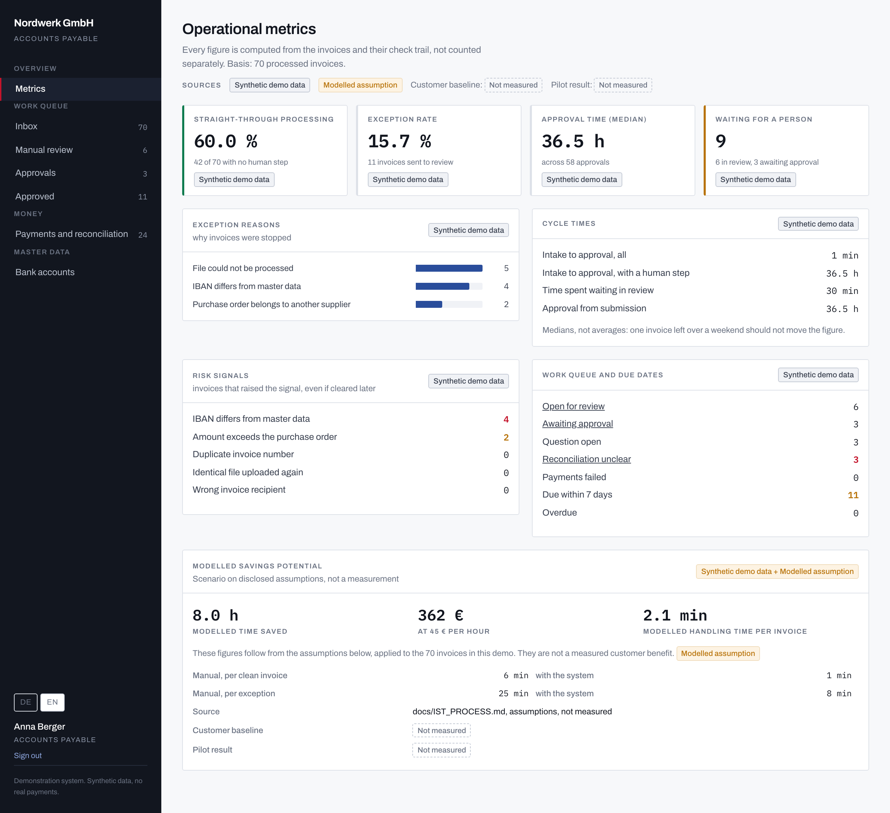
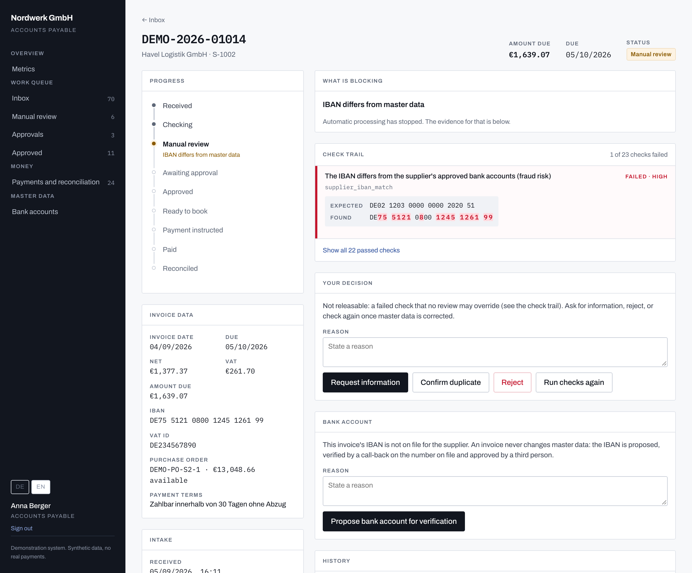

# Finance Operations Automation (DE) - E-Invoice to Payment

[](https://github.com/shotatsertsvadze/finance-ops-automation-de/actions/workflows/ci.yml)

**At a glance:** Node 22, Express 5, PostgreSQL 14, React 19. 489 automated
tests: unit, integration against a real database, and browser. 76 decision
records. `docker compose up` gives a running demo with a month of synthetic
invoices on http://localhost:4400.

## Why this exists

The opportunity is not parsing an e-invoice; it is automating the finance
operations that begin once an invoice becomes machine-readable. Reading an
XRechnung is a solved problem, and this project treats it as a starting point
rather than the product.

What still costs a German SME real hours is the operational work around the
document: validating it against supplier, IBAN and purchase-order master data,
routing exceptions to the right person, collecting approvals, handing a booking
record to accounting, tracking payment status, reconciling the bank statement,
and knowing what any of it cost. That is the workflow this PoC implements, for
the German B2B market.

Concretely: an XRechnung arrives, the system validates it technically and
against the company's own master data, routes it deterministically, gets the
right people to approve it, hands it to accounting, tracks payment and
reconciles it. Every state change is audited. Uncertain cases go to humans;
nothing is approved by default.

Demo company: Nordwerk GmbH (fictional). All data is synthetic.

## Status

A working, portfolio-grade proof of concept. The invoice workflow runs end to
end - intake, validation, deterministic controls, approvals, exception
handling, accounting handoff, payment status, reconciliation and operational
KPIs - on synthetic demo data only.

It is not production software, and it is not a claim of legal, EN 16931 or
GoBD compliance. What it deliberately does not do is listed under
"Known limits" below; the reasoning behind every decision is in
`docs/DECISIONS.md`, and two independent control reviews and their remediation
are recorded in `docs/PHASE_0_INDEPENDENT_REVIEW.md` and
`docs/PROJECT_REVIEW_2026-09-17.md`.



The metrics view after a demo run of 70 synthetic invoices. Every figure is
derived from the invoices and their check trail rather than counted separately.
The interface is German by default and switches to English.

## What is worth looking at

- **One way to change state.** `invoices.state` moves only through `transition()`
  in `server/domain/workflow/transitions.js`, which writes the audit event in the
  same transaction. No route, script or SQL trigger writes it directly, and the
  legal transitions are a declared table rather than scattered conditions.
- **Checks produce evidence, not verdicts.** Every check returns `check, status,
  severity, expected, actual, reason, recommended_action`, so a reviewer is shown
  what was expected and what the document actually carried, with the differing
  characters marked for things like a changed IBAN.
- **Fail closed.** Missing, malformed or uncertain data routes to review, never to
  approval. A few checks cannot be overridden at all: a reviewer is there to judge
  business facts, not to supply arithmetic the document never did.
- **Amounts are recomputed, not read.** Discounts, surcharges and prepayments are
  computed along EN 16931's calculation chain, and every line is recomputed from
  its quantity and unit price - exactly, not in floating point, because the
  tolerance is one cent (ADR-047, ADR-048).
- **Nothing is inferred.** Routing is a pure function of the check results and the
  amount policy. No model decides anything, and none sits anywhere near the
  payment path.



An invoice the system stopped: its IBAN is not one of the supplier's approved
accounts, the most common invoice-fraud pattern. The characters that differ are
marked. Because no reviewer may wave a changed IBAN through, the screen does
not offer the release at all: the account has to be verified into master data
first, by three different people, and the invoice is then checked again
(ADR-052, ADR-071, ADR-077).

The reasoning behind each decision is in `docs/DECISIONS.md`, every behaviour has
a row in `docs/TEST_MATRIX.md`, and what the system does *not* do is listed under
"Known limits" below rather than left to be discovered.

## Quick start

With Docker, nothing else to install:

```bash
docker compose up
```

Open http://localhost:4400 and sign in with a demo account (below). Every start
rebuilds a fresh month of synthetic invoices.

## Setup

For development, with Node.js 22+ and PostgreSQL 14+:

```bash
npm install
cp .env.example .env        # set DATABASE_URL and TEST_DATABASE_URL
createdb finops             # or any database named in DATABASE_URL
npm run db:migrate
npm run db:seed
npm run dev                 # API on http://localhost:4400, UI on http://localhost:5400
```

Official validation (optional in development, required in production): the
pinned KoSIT validator runs as a local daemon and needs Java 11 or newer.
Without it the check is skipped and says so.

```bash
npm run kosit:fetch         # pinned jar and configuration, SHA-256 checked, into vendor/kosit
KOSIT_JAVA=/path/to/java npm run kosit   # daemon on 127.0.0.1:8081; leave KOSIT_JAVA out if `java` is 11+
# then in .env: KOSIT_URL=http://127.0.0.1:8081
```

Tests:

```bash
createdb finops_test
npm test
KOSIT_TEST_URL=http://127.0.0.1:8081 npm run test:kosit   # against the running validator
```

Production (one process serves the API and the built client):

```bash
# once, as a database superuser
psql -c "create role finops_app login password '...'"
# as the schema owner, after every migration
DATABASE_URL=$OWNER_URL npm run db:migrate
DATABASE_URL=$OWNER_URL npm run db:grant -- finops_app
printf '%s' "$PASSWORD" | DATABASE_URL=$OWNER_URL npm run user:password -- jonas.weber@nordwerk.example   # every account
# the app itself connects as finops_app
npm run build
DATABASE_URL=$APP_URL npm start   # NODE_ENV=production
```

`npm start` refuses to run without `KOSIT_URL`, while `dist/` is missing, while any account still has
the demo password, or while its database role could change the audit trail
(the owner can; `finops_app` cannot). `DEMO_MODE=true` allows the demo password
on purpose, for a hosted demo. Cookies are `Secure` in production, so it must sit behind HTTPS;
the API listens on `127.0.0.1` unless `API_HOST` says otherwise, which suits a
reverse proxy on the same host. Route traffic on `/api/health/ready`, which
checks the database; logs are JSON lines on stdout and stderr, and every
response carries an `X-Request-Id` to find its line.

## Try it

`docs/DEMO.md` walks through the system in ten minutes. To try a single
document, upload a fixture from `fixtures/xrechnung/` in the UI, or sign in
and send it with the CSRF token, as the browser does:

```bash
curl -c jar -H 'Content-Type: application/json' \
  -d '{"email":"anna.berger@nordwerk.example","password":"nordwerk-demo"}' \
  http://localhost:4400/api/auth/login
curl -b jar -H "X-CSRF-Token: $(awk '$6 == "finops_csrf" {print $7}' jar)" \
  -F file=@fixtures/xrechnung/A_clean_1240.xml http://localhost:4400/api/invoices
```

The outcomes below are for one fixture on a freshly seeded system (D after A).
The fixtures share purchase orders, so uploaded together the later ones can
meet an order the earlier ones already used.

| Fixture | Scenario | Expected |
|---|---|---|
| A | clean, 1 240 EUR | waits for one manager approval |
| B | IBAN differs from supplier master data | review, HIGH |
| C | invoice 8 500 EUR, PO remaining 5 000 EUR | review, HIGH |
| D | same number as A, different file | review, duplicate suspicion |
| E | clean, 30 000 EUR | manager + finance + CFO |
| F | malformed | review, technical failure |
| G | clean, 380 EUR | approved automatically |
| H | IBAN differs, 380 EUR | review, HIGH; a small amount is no reason to skip the check |
| I | 3 % discount: 450 EUR of lines, 30 EUR off, 499.80 EUR due | approved automatically; without the discount 535.50 EUR would need a manager |
| J | credit note for 214.20 EUR, crediting RE-2026-4471 | approved, booked as a negative record, closed as credited, never paid |

## Documentation

- `docs/PRODUCT.md` - what and for whom
- `docs/ARCHITECTURE.md` - stack, data model, state machine, API, adapters
- `docs/DECISIONS.md` - decision records, assumptions
- `docs/IST_PROCESS.md`, `docs/SOLL_PROCESS.md` - current vs. target process
- `docs/BUSINESS_CASE.md` - demo assumptions
- `docs/TEST_MATRIX.md` - what is verified and how
- `docs/IMPLEMENTATION_PLAN.md` - what was built in which order
- `docs/DEMO.md` - a twelve-minute walkthrough, in order
- `docs/DEMO_VIDEO.md` - three-minute video storyboard and narration
- `docs/REFERENCE_AUDIT.md` - audit of the two reference repositories
- `docs/CUSTOMER_DISCOVERY.md` - ICPs, interview guide, baseline model, pilot criteria
- `docs/FINANCE_OPS_2_PLAN.md` - the next phase: master-data control, integrations, AI, ROI

## Known limits

These are reproduced and accepted, not hidden. Full list with reproductions in
`docs/TEST_MATRIX.md` under "Known limitations".

- **A purchase order is a single balance, not a line-by-line receipt.**
  Capacity is committed, released and given back by a credit note, but partial
  deliveries and order closure are not modelled.
- **A credit note is applied to the next payment, not to the invoice it
  names.** It runs the same checks, reduces the order, is never paid, and its
  open balance offsets the next payment to that supplier - oldest credit first.
  The reference to the invoice being credited is read and shown, but does not
  steer which payment it reduces.
- **Reconciliation matches one statement line to one invoice.** Part payments
  and collective payments covering several invoices are not modelled; each
  becomes an exception for a person to resolve.
- **A new bank account is added, not substituted.** A supplier's previous
  account stays trusted, and payable, until retiring accounts is built.
- **Authentication is demo-grade.** Real password login, sessions and a role
  matrix, but no password reset, no second factor and no SSO. Accounts are
  seeded with a shared, documented password.
- Only XRechnung in UBL syntax is parsed. CII and ZUGFeRD are adapter boundaries.
- Official validation is the KoSIT validator 1.6.3 with the XRechnung 3.0.2
  configuration of 2026-08-31, pinned (ADR-078). The check reports its
  assessment; the system certifies nothing. A rejected invoice cannot be
  processed by hand yet: the supplier sends a corrected one. The call runs
  inside the invoice's transaction, and the readiness check does not ask the
  validator.
- Accounting, payment and bank data are simulated.
- Approval thresholds and savings figures are demo assumptions.

## What a production deployment would add

This is a simulation built to show the workflow and its controls. The code is
production-shaped where it matters for correctness: every state change is
transactional and audited, money moves are idempotent, input is validated, and
a production start refuses demo passwords and an unprotected audit trail. A
real deployment would still need:

- **A bank connection.** Payments leave as a SEPA file (pain.001) or through a
  bank API via an outbox, and "paid" or "failed" comes from the bank's own
  statements (camt.053/054) rather than a button.
- **An accounting export the books import.** DATEV's Buchungsstapel format or
  the ERP's API, in numbered batches so a re-send can never double-book.
- **Company identity.** Single sign-on with a second factor, and user
  lifecycle (joiners, leavers, role changes) managed there.
- **Operations.** Point-in-time database backups, originals in write-protected
  object storage for the retention period, a secrets manager, central logs
  with alerts on errors and stuck invoices, and a tested rollback path.
- **The other e-invoice syntax.** CII and ZUGFeRD; the validator already
  carries their rules, the parser does not read them.
- **The validator as a service.** A KoSIT container on an internal network,
  its health in the readiness check, and a screen for the retry after an
  outage.

## When an intake does not finish

Receiving a file and processing it are separate steps, so an arrival is
recorded even if the run that reads it fails. Sending the same file again
resumes that invoice rather than answering "duplicate"; a file sent again after
processing finished is still a duplicate. See ADR-044.

## Handing figures to accounting

`GET /api/accounting/export` returns the booking records as CSV for a
bookkeeping import, with values exactly as they arrived. Add
`?profile=spreadsheet` for a copy in which cells a spreadsheet would execute
are made inert; the two download under different names. See ADR-045.

## Refusals

A refusal from the server carries a stable code and the parameters its sentence
uses, alongside the German sentence itself. The interface renders it in the
chosen language and falls back to the server's wording when it does not know a
code, so an error is never swallowed by a missing translation. See ADR-042.

## Stored originals

The uploaded file is kept byte for byte and served back as source text, never
as a type a browser will render. A document refused as an invoice can still be
a working web page, and rendering it on the API's own origin would run it with
the session of whoever opened the link. See ADR-035.

## Display language

The interface runs in German or English; the switch is at the bottom of the
sidebar and the choice is remembered per browser. German is the product's
language and the one the server generates and stores, so supplier names,
document text and comments people typed stay in German either way. See
ADR-034.

## Signing in

The demo accounts share one password, `nordwerk-demo`, set by `npm run db:seed`
and overridable with `DEMO_PASSWORD`. These are synthetic accounts in a local
demo; a production start refuses them (see Setup).

| Account | Role | May |
|---|---|---|
| anna.berger@nordwerk.example | Kreditorenbuchhaltung | upload, review decisions |
| tim.kessler@nordwerk.example | Kostenstellenleitung | upload, approval steps |
| lea.sommer@nordwerk.example | Kostenstellenleitung | upload, approval steps |
| jonas.weber@nordwerk.example | Finanzen | review, approval, the money path |
| mira.hoffmann@nordwerk.example | Finanzen | as above |
| sabine.vogt@nordwerk.example | CFO | upload, approval steps |

Passwords are hashed with scrypt and a per-user salt. The session is a random
token in an HttpOnly, SameSite=Strict cookie; only its hash is stored, so a
database dump yields no usable session. Signing out revokes it server-side.
State-changing requests carry a CSRF token. Repeated failed logins throttle
the client address, never the account, so a guesser cannot lock its owner out.
Behind a reverse proxy, the proxy must be on the same host and set
`X-Forwarded-For`. A wrong password
and an unknown address get the same answer and cost the same work, so neither
the wording nor the response time says whether the account exists.

Finance is deliberately the one role that may both review and approve. That is
what makes the four-eyes rule after a review meaningful rather than theoretical.

## Working an invoice

Every action is authorised server-side against the signed-in session. The UI
hides what your role may not do; the server refuses it either way.

An invoice in review can be sent to approval, rejected, put on hold with a
query, or confirmed as a duplicate. Rejection, query and duplicate need a
reason. Sending an exception to approval never approves it: it always produces
at least one approval step, and the person who released it cannot take that
step. Approval steps run in order, each needs the exact role, and no one may
decide two steps of the same invoice.

## A new supplier bank account

An invoice stopped because its IBAN is not on file offers **Bankverbindung zur
Prüfung vorschlagen**; the invoice itself never changes master data. Under
**Bankverbindungen**, a second person records a call-back on the number already
in master data, with the IBAN the supplier reads back, and a third approves.
The account is then added, and the invoices stopped for it are validated again
in a new run; one waiting for information is taken by **Rechnungen erneut
prüfen** once the information is in. Clerk and finance propose, finance and the
CFO verify and approve; administration takes no step and may only ask for the
technical revalidation retry (ADR-077).

## Money path and reconciliation

An approved invoice is handed to accounting as a booking record, paid through
a simulated provider, and matched against a synthetic bank statement. Under
"Zahlungen und Abgleich" you can import the demo statement that `npm run
db:demo` writes (see Dashboard below) and run the match.

Each payment is sent with its own end-to-end id (`NW-P-00000001`) ahead of the
invoice number, and a bank line is matched only when it names that id and the
amount agrees; the supplier's invoice number alone identifies nothing. A payment whose amount happens to equal an invoice is
never matched on that basis alone: it becomes an exception for a person to
resolve. The tests use a smaller statement in `fixtures/bank/`, written for the
hand-written fixtures: one clean match, one amount-only payment, one part
payment and one payment that matches nothing.

Booking accounts and tax keys in the export are demo assignments, not a
certified SKR mapping.

## Dashboard

```bash
npm run db:reset && npm run db:demo   # a month of synthetic invoices
```

`npm run db:demo` pushes every generated invoice through the real pipeline and
then shifts the timestamps into the past, so the cycle-time figures are
meaningful rather than sub-second. It also writes the bank statement that
answers its own payments to `client/public/demo/`, imports it and reconciles
it, so the last stage of the process has something to show. That statement is
deliberately imperfect: two short payments, a payment to the wrong account, one
that names no payment, and two payments the bank has not reported yet. A month
of lines that all matched would demonstrate nothing.

The same seed produces the same invoices, amounts and relative timings. The
dates are not fixed: the month ends today, so regenerating on another day
shifts them and rewrites the committed statement. The data is synthetic.

Every dashboard figure is computed from the invoices and their audit events.
There is no counter to drift. Each figure names its source: synthetic demo
data, a modelled assumption, or both. The savings panel is a modelled
potential, not a measured benefit. Customer baseline and pilot result read
"not measured", because nothing has been measured (ADR-079).

## Licence

MIT, see `LICENSE`. The data, the company and the figures are invented.
