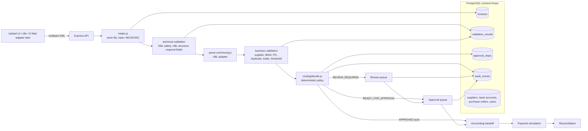
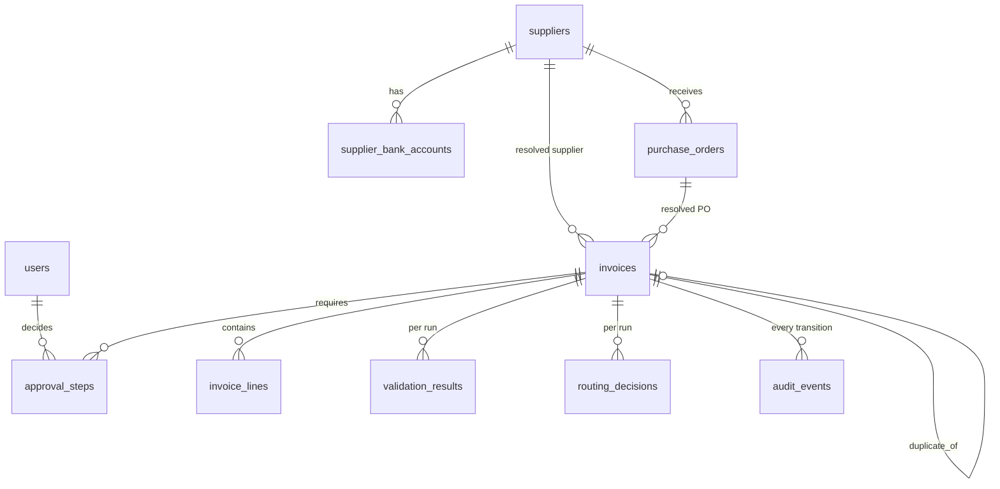
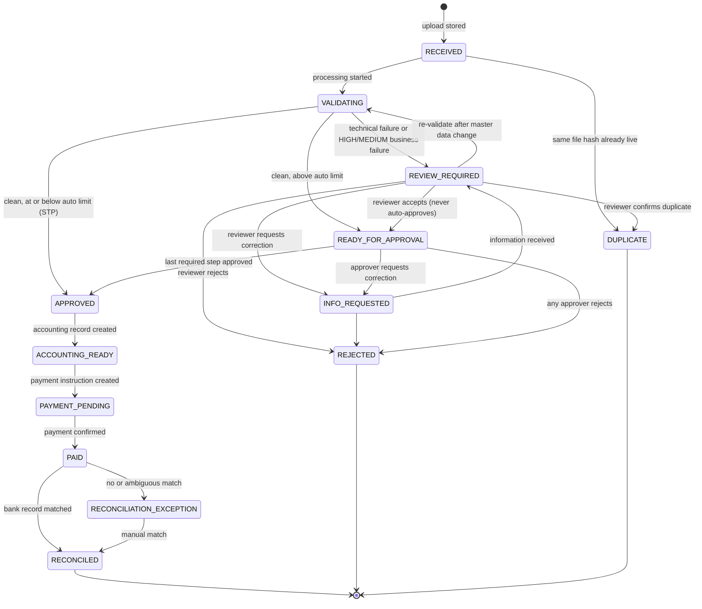

# Architecture

## 1. Stack

| Layer | Choice | Why |
|---|---|---|
| API | Node.js 22+ (ESM), Express 5 | Known to the author, smallest runtime, no build step |
| Database | PostgreSQL 14+, schema `finops`, accessed with `pg` | Runs locally today; identical SQL on Supabase later |
| Files | Local `storage/` in the MVP, path `<invoice_id>/original.xml` | Bucket-compatible path; swap to Supabase Storage behind one module |
| XML | `fast-xml-parser` with DTD processing off, `<!DOCTYPE` rejected | No entity expansion, no XXE |
| UI | React 19 + Vite 8, react-router 7, plain CSS with design tokens | Operations console; German or English display, one dictionary per language (ADR-034) |
| Tests | `node --test` | No framework dependency; pure-function tests plus a local test database |
| Workflow engine | none in Phases 1-3 | See `docs/DECISIONS.md` ADR-004 |
| AI | none in the XRechnung path | Structured data needs no extraction; see ADR-006 |

## 2. System diagram



Every arrow that changes `invoices.state` goes through `transition()` in
`server/domain/workflow/transitions.js`, which writes the audit event in the
same database transaction.

## 3. Repository layout

```
finance-ops-automation-de/
  README.md  AGENTS.md  CLAUDE.md  .env.example  package.json
  docs/                    PRODUCT, ARCHITECTURE, IST/SOLL process, BUSINESS_CASE,
                           DECISIONS, TEST_MATRIX, REFERENCE_AUDIT, IMPLEMENTATION_PLAN
  fixtures/xrechnung/      demo invoices A-G (synthetic UBL 2.1 / XRechnung 3.0 profile)
  db/migrations/           append-only SQL, applied by scripts/migrate.js
  db/seed/                 synthetic master data (users, suppliers, IBANs, POs)
  scripts/                 migrate.js, seed.js, create-test-db.js
  server/
    index.js               starts the HTTP server
    app.js                 createApp(): express app without listen (used by tests)
    db.js                  pool, withTransaction, type parsers
    config/policy.js       thresholds and tolerances (env-overridable)
    domain/
      invoice/             xml-safety.js, parse-xrechnung.js (UBL adapter), technical-validation.js
      validation/          business-checks.js (each check returns a CheckResult)
      routing/             decide.js (pure), policy application
      workflow/            states.js (state + transition table), transitions.js (transition())
      audit/               audit.js (writeEvent)
      intake/              intake.js (orchestration of one upload)
      approvals/           Phase 2
      accounting/ payments/ reconciliation/   Phase 3 (adapter boundaries)
    routes/                invoices.js, master-data.js, users.js
    storage/               files.js (store/read original file)
  client/
    index.html  vite.config.js
    src/                   App.jsx, features/inbox, features/invoice-detail, features/upload, ...
  storage/                 original files (gitignored)
```

## 4. Domain model



Key columns (full definitions in `db/migrations/0001_core.sql`):

- `invoices`: intake facts (`received_at`, `source_channel`, `original_filename`,
  `file_sha256`, `file_path`, `file_size_bytes`) are written once and never
  updated. Extracted fields (`invoice_number`, `issue_date`, `due_date`,
  `supplier_name_raw`, `supplier_vat_id_raw`, `supplier_iban_raw`,
  `buyer_reference`, `po_reference_raw`, `currency`, `net_amount`, `vat_amount`,
  `gross_amount`, `payment_terms_raw`, `parsed jsonb`) come from the document.
  Resolved references (`supplier_id`, `purchase_order_id`) come from business
  validation. `state` is the workflow state, `review_reason` the current blocker.
- `validation_results`: one row per check per run
  (`phase`, `check_code`, `status`, `severity`, `expected`, `actual`, `reason`,
  `recommended_action`).
- `routing_decisions`: the decision, the reasons and the required approval
  steps as computed by the policy, with the policy snapshot.
- `approval_steps`: `step_no`, `required_role`, `status`, `actor_id`,
  `decided_at`, `comment`, and what the decision was given for:
  `document_sha256`, `validation_run_no`, `decided_gross` (migration
  `0007_approval_binding.sql`). The next approval step and the accounting
  handoff both refuse with 409 when the invoice no longer matches a step
  already decided (ADR-033).
- `invoices.review_accepted_by`: who released the invoice from review, so that
  person can be excluded from approving it (migration `0002_review_actor.sql`).
- `audit_events`: `occurred_at`, `actor_type` (SYSTEM|HUMAN), `actor_id`,
  `action`, `from_state`, `to_state`, `reason`, `evidence jsonb`.

Bank transactions carry a status of `UNMATCHED`, `MATCHED`, `EXCEPTION` or
`RESOLVED`. `RESOLVED` is set when a person closes an exception by hand, in the
same transaction as the invoice, and never re-enters matching (ADR-036).

Before an approval is recorded the business checks run again against current
master data. A check that was not failing at the last run and is failing now
sends the invoice back to `REVIEW_REQUIRED` with its steps cancelled; one that
was already failing was seen by a reviewer and does not (ADR-041).

Database-enforced invariants:

- `unique (file_sha256) where state <> 'DUPLICATE'`: the same file can exist
  once as a live invoice.
- `unique (supplier_id, invoice_number) where state in (payable states)`: two
  payable records for the same supplier invoice number are impossible.
- `unique (invoice_id, step_no)` on approval steps.
- `check (actor_type = 'SYSTEM' or actor_id is not null)` on audit events.

## 5. State machine



Rules:

- Terminal states: `RECONCILED`, `REJECTED`, `DUPLICATE`. No transition leaves them.
- Payable states (money may move): `APPROVED`, `ACCOUNTING_READY`,
  `PAYMENT_PENDING`, `PAID`, `RECONCILED`.
- A human review never ends in `APPROVED` directly. It ends in
  `READY_FOR_APPROVAL` with at least one approval step, and the reviewer cannot
  take that step (configurable four-eyes after review).
- `INFO_REQUESTED` always returns to `REVIEW_REQUIRED`; existing approvals are
  cancelled and re-validation runs.
- Changes vs. the brief's draft model: `DUPLICATE` and `INFO_REQUESTED` are
  explicit states, `RECONCILIATION_EXCEPTION` is explicit, and `VALIDATING` is
  the only transient state. There is no separate "technical failed" state:
  a malformed file is an exception for humans, so it goes to `REVIEW_REQUIRED`
  with `review_reason = TECHNICAL_VALIDATION_FAILED`.

## 6. Validation and routing

Technical validation (`domain/invoice/technical-validation.js`) answers "can we
process this as a structured invoice":

| check_code | severity | fails when |
|---|---|---|
| `xml_well_formed` | HIGH | not parseable, or contains `<!DOCTYPE` |
| `format_recognised` | HIGH | root is not UBL `Invoice` (CII/ZUGFeRD: adapter boundary, reported as unsupported) |
| `xrechnung_profile_declared` | MEDIUM | `CustomizationID` does not name XRechnung |
| `required_fields_present` | HIGH | invoice number, issue date, supplier name, currency, payable amount or lines missing |
| `amounts_numeric` | HIGH | any amount fails decimal parsing |

Business validation (`domain/validation/business-checks.js`) answers "does this
invoice make sense for Nordwerk":

| check_code | severity | fails when |
|---|---|---|
| `supplier_known` | HIGH | no supplier matches VAT ID (fallback: exact legal name) |
| `supplier_active` | HIGH | supplier status is not ACTIVE |
| `supplier_iban_match` | HIGH | invoice IBAN not among the supplier's ACTIVE accounts |
| `duplicate_invoice_number` | HIGH | same supplier + invoice number exists in a non-DUPLICATE, non-REJECTED state |
| `po_reference_present` | MEDIUM | no PO reference and policy requires one |
| `po_exists` | HIGH | PO reference present but unknown |
| `po_supplier_match` | HIGH | PO belongs to another supplier |
| `po_amount_within_tolerance` | HIGH | net amount exceeds PO remaining amount by more than tolerance |
| `totals_consistent` | HIGH | lines vs. net, net + VAT vs. gross differ by more than 0.01 |
| `currency_expected` | MEDIUM | currency not in the allowed list |
| `required_fields_complete` | MEDIUM | due date, IBAN, buyer reference missing |
| `payment_terms_match` | LOW | payment terms differ from supplier master (warning only) |
| `approval_threshold` | informational | reports which approval tier applies |

Routing (`domain/routing/decide.js`, pure function):

1. Any technical FAILED → `REVIEW_REQUIRED`, reason `TECHNICAL_VALIDATION_FAILED`.
2. Any business FAILED with severity HIGH or MEDIUM → `REVIEW_REQUIRED`, reason is
   the first HIGH check code (or MEDIUM if no HIGH).
3. Otherwise, gross amount ≤ `AUTO_APPROVE_LIMIT` → `APPROVED` (actor SYSTEM,
   action `auto_approved`).
4. Otherwise → `READY_FOR_APPROVAL` with steps from the policy tiers.

Policy defaults (`server/config/policy.js`, demo assumptions, not legal
requirements): auto limit 500 EUR; ≤ 5 000 EUR one MANAGER; ≤ 25 000 EUR MANAGER
+ FINANCE; above that MANAGER + FINANCE + CFO. PO tolerance 2 % of the PO
remaining amount, minimum 10 EUR. Allowed currency EUR. PO required for every
invoice above the auto limit.

## 7. API boundaries

| Method | Path | Phase | Purpose |
|---|---|---|---|
| POST | `/api/invoices` | 1 | multipart upload (`file`, `source_channel`), runs the pipeline, returns the invoice |
| GET | `/api/invoices` | 1 | list with optional `state` filter |
| GET | `/api/invoices/:id` | 1 | invoice, lines, latest validation results, routing decision, approval steps, audit events |
| GET | `/api/invoices/:id/file` | 1 | original XML |
| POST | `/api/invoices/:id/reprocess` | 1 | re-run validation from RECEIVED/VALIDATING/REVIEW_REQUIRED |
| GET | `/api/master-data/suppliers`, `/purchase-orders`, `/api/users` | 1 | read-only master data |
| POST | `/api/invoices/:id/review/accept\|reject\|request-info\|confirm-duplicate` | 2 | reviewer actions; `request-info` is also valid from READY_FOR_APPROVAL |
| POST | `/api/invoices/:id/info-received` | 2 | INFO_REQUESTED back to REVIEW_REQUIRED |
| POST | `/api/invoices/:id/approvals/:stepNo/approve\|reject` | 2 | approver actions |
| POST | `/api/invoices/:id/accounting-record` | 3 | APPROVED to ACCOUNTING_READY, creates the booking record |
| POST | `/api/invoices/:id/payment` | 3 | creates the payment instruction, ACCOUNTING_READY to PAYMENT_PENDING |
| POST | `/api/invoices/:id/payment/confirm` | 3 | simulated provider confirmation, PAYMENT_PENDING to PAID |
| POST | `/api/invoices/:id/reconciliation/resolve` | 3 | closes a reconciliation exception, reason required |
| GET | `/api/accounting/export` | 3 | CSV of all booking records |
| POST | `/api/bank/import` | 3 | imports a synthetic statement, idempotent on `external_id` |
| GET | `/api/bank/transactions` | 3 | statement lines with match status and reason |
| POST | `/api/reconciliation/run` | 3 | matches unmatched transactions against paid invoices |
| GET | `/api/dashboard/kpis` | 4 | operational KPIs |

Actor identity: `X-Actor-Id` header resolved against `users`. Missing or unknown
actor on a human action → 400. This is an MVP boundary, not authentication
(ADR-005).

## 8. Adapter boundaries

- `domain/invoice/parse-xrechnung.js` exports `parseInvoiceXml(buffer)` returning a
  format-neutral `ParsedInvoice`. A CII/ZUGFeRD parser will implement the same
  output; the detector in `technical-validation.js` chooses the parser.
- `domain/invoice/external-validator.js` (Phase 5) is a stub interface for an
  official EN 16931 / XRechnung validator (e.g. the KoSIT validator). Until it is
  wired, the system reports "profile declared" and "structure checked", never
  "compliant".
- `domain/accounting/accounting.js` builds a vendor-neutral booking record;
  `exportAccountingCsv()` is one formatter over it, and a DATEV or SAP adapter
  would be another. Account numbers and tax keys are demo assignments (ADR-018).
- `domain/payments/payments.js` holds `mockProvider`; a bank API adapter
  replaces that object and nothing else.
- `domain/reconciliation/matching.js` is a pure function, so the matching policy
  can be changed and tested without touching persistence.
- `storage/files.js` hides local disk vs. bucket.

## 9. Security and privacy (MVP)

- XML parsed with entity and DTD processing disabled; files with `<!DOCTYPE`
  rejected before parsing; 5 MB upload limit; only `.xml` accepted.
- No secrets in the repository; `.env.example` has placeholders only.
- Original files are immutable; deletion is not exposed by the API.
- All data is synthetic. Personal data in a real deployment would be limited to
  supplier contact data and approver identities; retention would follow the
  German 8/10-year rules for accounting records (GoBD, HGB/AO), which this MVP
  documents but does not implement.
- No formal compliance claims (EN 16931, GoBD, GDPR certification). See
  `docs/DECISIONS.md` ADR-008 for the wording rules.
