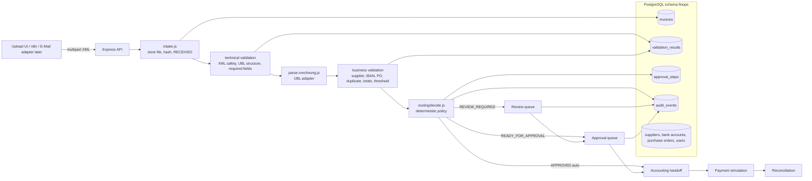
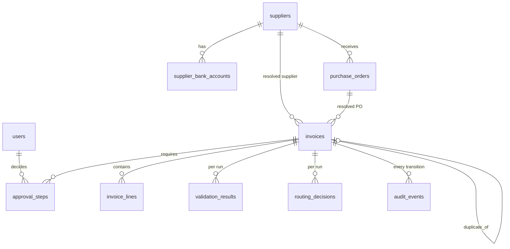
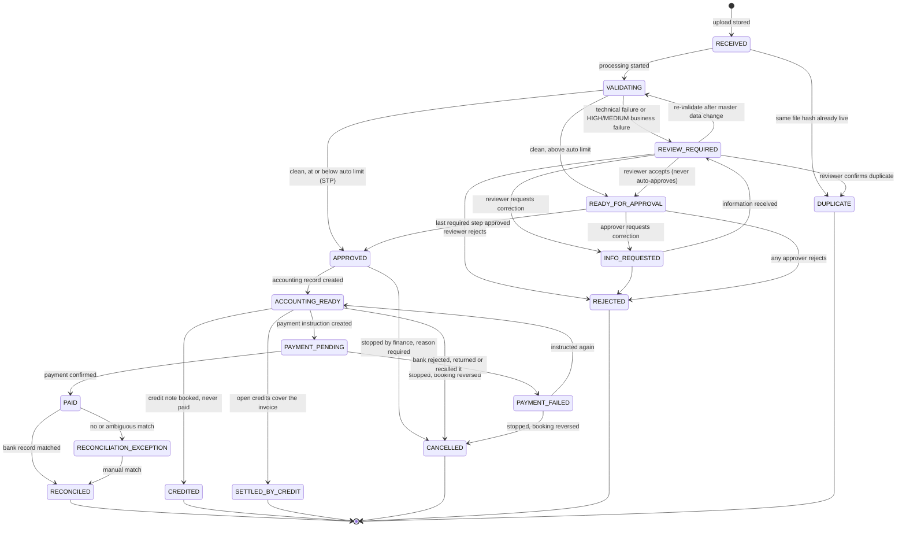

# Architecture

## 1. Stack

| Layer | Choice | Why |
|---|---|---|
| API | Node.js 22+ (ESM), Express 5 | Known to the author, smallest runtime, no build step |
| Database | PostgreSQL 14+, schema `finops`, accessed with `pg` | Runs locally today; identical SQL on Supabase later |
| Files | Local `storage/` in the MVP, path `<invoice_id>/original.xml` | Bucket-compatible path; swap to Supabase Storage behind one module |
| XML | `fast-xml-parser` with DTD processing off, `<!DOCTYPE` rejected | No entity expansion, no XXE |
| UI | React 19 + Vite 8, react-router 7, plain CSS with design tokens | Operations console; German or English display, one dictionary per language (ADR-034), refusals included (ADR-042) |
| Tests | `node --test` | No framework dependency; pure-function tests plus a local test database |
| Workflow engine | none in Phases 1-3 | See `docs/DECISIONS.md` ADR-004 |
| AI | none in the XRechnung path | Structured data needs no extraction; see ADR-006 |

## 2. System diagram



Every arrow that changes `invoices.state` goes through `transition()` in
`server/domain/workflow/transitions.js`, which writes the audit event in the
same database transaction.

## 3. Repository layout

```
finance-ops-automation-de/
  README.md  AGENTS.md  CLAUDE.md  .env.example  package.json
  docs/                    PRODUCT, ARCHITECTURE, IST/SOLL process, BUSINESS_CASE,
                           DECISIONS, TEST_MATRIX, DEMO, DEMO_VIDEO, reviews
  .github/workflows/       CI: the suite against a Postgres service container, then the build
  fixtures/xrechnung/      demo invoices A-J (synthetic UBL 2.1 / XRechnung 3.0 profile)
  fixtures/bank/           synthetic bank statement for the tests
  db/migrations/           append-only SQL, applied by scripts/migrate.js under an advisory lock; an applied file that changed stops the run (ADR-061)
  db/seed/                 synthetic master data (users, suppliers, IBANs, POs)
  scripts/                 migrate.js, seed.js, reset.js, set-password.js, demo-data.js, demo-walkthrough.mjs
  server/
    index.js               starts the HTTP server; refuses an unsafe production start
    app.js                 createApp(): express app without listen (used by tests)
    db.js                  pool, withTransaction, type parsers
    log.js request-log.js  JSON log lines; request id and one line per request
    auth/                  passwords (scrypt), sessions (cookie + CSRF), authorize (role matrix), set-password
    config/                policy.js, company.js, assumptions.js, tax-keys.js, deployment.js
    domain/
      invoice/             xml-safety.js, parse-xrechnung.js (UBL adapter), technical-validation.js, queries.js
      validation/          business-checks.js, tax-breakdown.js, lookup.js (each check returns a CheckResult)
      routing/             decide.js (pure)
      workflow/            states.js (transitions and phases), transitions.js (transition(), audit), eligibility.js
      intake/              intake.js (orchestration of one upload)
      approvals/           review and approval decisions, binding, final re-check
      purchase-orders/     commitments.js (capacity ledger)
      accounting/ payments/ reconciliation/ kpi/
    routes/                auth, session, health, invoices, master-data, money
    storage/               files.js (store/read original file)
    test-support/          test database, demo users, invoice XML builder
  client/
    index.html  vite.config.js
    src/                   App.jsx, lib/ (api, i18n, dictionaries), features/ (auth, inbox, invoice,
                           upload, payments, dashboard)
  browser/                 Playwright tests for what only a browser can show
  storage/                 original files (gitignored)
```

## 4. Domain model



Key columns (full definitions in `db/migrations/0001_core.sql`):

- `invoices`: intake facts (`received_at`, `source_channel`, `original_filename`,
  `file_sha256`, `file_path`, `file_size_bytes`) are written once and never
  updated. Extracted fields (`invoice_number`, `issue_date`, `due_date`,
  `supplier_name_raw`, `supplier_vat_id_raw`, `supplier_iban_raw`,
  `buyer_reference`, `po_reference_raw`, `currency`, `net_amount`, `vat_amount`,
  `gross_amount`, `payment_terms_raw`, `parsed jsonb`) come from the document.
  Resolved references (`supplier_id`, `purchase_order_id`) come from business
  validation. `state` is the workflow state, `review_reason` the current blocker.
- `validation_results`: one row per check per run
  (`phase`, `check_code`, `status`, `severity`, `expected`, `actual`, `reason`,
  `recommended_action`).
- `routing_decisions`: the decision, the reasons and the required approval
  steps as computed by the policy, with the policy snapshot.
- `approval_steps`: `round`, `step_no`, `required_role`, `status`, `actor_id`,
  `decided_at`, `comment`, and what the decision was given for:
  `document_sha256`, `validation_run_no`, `decided_gross` (migration
  `0007_approval_binding.sql`). Each release into approval starts a new
  round; earlier rounds stay, cancelled, and the detail returns them as
  `approval_history` (ADR-067). The next approval step and the accounting
  handoff both refuse with 409 when the invoice no longer matches a step
  already decided (ADR-033).
- `invoices.review_accepted_by`: who released the invoice from review, so that
  person can be excluded from approving it (migration `0002_review_actor.sql`).
- `audit_events`: `occurred_at`, `actor_type` (SYSTEM|HUMAN), `actor_id`,
  `action`, `from_state`, `to_state`, `reason`, `evidence jsonb`.

Bank transactions carry a status of `UNMATCHED`, `MATCHED`, `EXCEPTION` or
`RESOLVED`. `RESOLVED` is set when a person closes an exception by hand, in the
same transaction as the invoice, and never re-enters matching (ADR-036).

A changed IBAN is not overridable: review cannot release it, and the payment
instruction pays only an ACTIVE master-data account of an ACTIVE supplier,
checked again at that moment. Whoever submitted an invoice cannot approve it
(ADR-052), and whoever signed an approval step can neither instruct nor
confirm its payment (ADR-056).

Before an approval is recorded the business checks run again against current
master data. A check that was not failing at the last run and is failing now
sends the invoice back to `REVIEW_REQUIRED` with its steps cancelled; one that
was already failing was seen by a reviewer and does not (ADR-041).

An invoice whose first processing run never finished stays in RECEIVED or
VALIDATING. Sending the same file again resumes it instead of recording a
duplicate, decided under a row lock so it cannot race a run still in progress
(ADR-044).

Database-enforced invariants:

- `unique (file_sha256) where state <> 'DUPLICATE'`: the same file can exist
  once as a live invoice.
- `unique (supplier_id, invoice_number) where state in (payable states)`: two
  payable records for the same supplier invoice number are impossible. The
  index lists its states in SQL; a test compares them with `PAYABLE_STATES`.
- `unique (invoice_id, step_no)` on approval steps.
- `check (actor_type = 'SYSTEM' or actor_id is not null)` on audit events.

## 5. State machine



Rules:

- Terminal states: `RECONCILED`, `CREDITED`, `SETTLED_BY_CREDIT`, `CANCELLED`, `REJECTED`, `DUPLICATE`. No transition leaves them.
- An approved invoice can be stopped until money is on its way: `APPROVED` or
  `ACCOUNTING_READY` to `CANCELLED`, finance only, with a reason. A booked
  invoice is reversed in the same transaction: the same lines, sign turned,
  under a new document number naming the original (ADR-054).
- A payment the bank did not carry out goes to `PAYMENT_FAILED`: the
  instruction is marked FAILED and the credits it spent are released
  (`credit_applications.released_at`). From there it is instructed again,
  as a new attempt with its own idempotency key, or stopped. At most one
  instruction per invoice is live (pending or executed), enforced by a
  partial unique index; a pending payment is stopped by failing first
  (ADR-055).
- Every state has one phase in `states.js` (ADR-051), and every list of states
  the code filters on is derived from it:

  | Phase | States | Payable | Holds PO capacity | Outstanding (due/overdue) |
  |---|---|---|---|---|
  | OPEN | RECEIVED, VALIDATING, REVIEW_REQUIRED, INFO_REQUESTED | | | yes |
  | AWAITING_APPROVAL | READY_FOR_APPROVAL | | yes | yes |
  | COMMITTED | APPROVED, ACCOUNTING_READY, PAYMENT_PENDING, PAYMENT_FAILED | yes | yes | yes |
  | SETTLED | PAID, RECONCILED, RECONCILIATION_EXCEPTION, CREDITED, SETTLED_BY_CREDIT | yes | yes | |
  | DISCARDED | REJECTED, DUPLICATE, CANCELLED | | | |
- A credit note (`document_type = 'CREDIT_NOTE'`, UNTDID 1001 code 381) shares
  every state up to `ACCOUNTING_READY` and then ends in `CREDITED`. The payment
  route refuses it, its booking record carries the amounts negated, and its
  claim on a purchase order is negative, so it gives capacity back (ADR-049).
- A booked credit reduces the next payment to the same supplier. What was
  applied is recorded in `credit_applications`; the payment instruction carries
  the netted amount, and reconciliation compares the bank line with that
  instruction, so it needed no change. An invoice the credits cover entirely
  reaches `SETTLED_BY_CREDIT` without a payment (ADR-050).
- Each payment instruction carries an `end_to_end_id` Nordwerk issues
  (`NW-P-` and eight digits, from a sequence, one per attempt) and a reference
  `<id> RE <invoice number>` in SEPA's characters, 140 at most. Reconciliation
  looks for the id, never for the supplier's invoice number; an instruction
  from before the id existed is still recognised by its reference (ADR-063).
- A human review never ends in `APPROVED` directly. It ends in
  `READY_FOR_APPROVAL` with at least one approval step, and the reviewer cannot
  take that step (configurable four-eyes after review).
- `INFO_REQUESTED` always returns to `REVIEW_REQUIRED`; existing approvals are
  cancelled and re-validation runs.
- Changes vs. the brief's draft model: `DUPLICATE` and `INFO_REQUESTED` are
  explicit states, `RECONCILIATION_EXCEPTION` is explicit, and `VALIDATING` is
  the only transient state. There is no separate "technical failed" state:
  a malformed file is an exception for humans, so it goes to `REVIEW_REQUIRED`
  with `review_reason = TECHNICAL_VALIDATION_FAILED`.

## 6. Validation and routing

Technical validation (`domain/invoice/technical-validation.js`) answers "can we
process this as a structured invoice":

| check_code | severity | fails when |
|---|---|---|
| `xml_well_formed` | HIGH | not parseable, or contains `<!DOCTYPE` |
| `format_recognised` | HIGH | root is not UBL `Invoice` (CII/ZUGFeRD: adapter boundary, reported as unsupported) |
| `xrechnung_profile_declared` | MEDIUM | `CustomizationID` does not name XRechnung |
| `required_fields_present` | HIGH | invoice number, issue date, supplier name, currency, payable amount or lines missing |
| `amounts_numeric` | HIGH | any amount fails decimal parsing |

Business validation (`domain/validation/business-checks.js`) answers "does this
invoice make sense for Nordwerk":

| check_code | severity | fails when |
|---|---|---|
| `supplier_known` | HIGH | no supplier matches VAT ID (fallback: exact legal name) |
| `supplier_active` | HIGH | supplier status is not ACTIVE |
| `supplier_iban_match` | HIGH | invoice IBAN not among the supplier's ACTIVE accounts; not overridable (ADR-052) |
| `duplicate_invoice_number` | HIGH | same supplier + invoice number exists in a non-DUPLICATE, non-REJECTED state |
| `po_reference_present` | MEDIUM | no PO reference and policy requires one |
| `po_exists` | HIGH | PO reference present but unknown |
| `po_supplier_match` | HIGH | PO belongs to another supplier |
| `po_amount_within_tolerance` | HIGH | net amount exceeds PO remaining amount by more than tolerance |
| `line_amounts_consistent` | HIGH | a line's declared amount differs from quantity x unit price / base quantity - allowances + charges by more than 0.01; overridable, unlike the totals chain |
| `credit_note_reference` | MEDIUM | a credit note names no invoice (asked only of credit notes) |
| `totals_consistent` | HIGH | any link of the EN 16931 chain is off by more than 0.01: lines vs. declared line total, allowances and charges vs. their totals, lines - allowances + charges vs. net, net + VAT vs. gross, gross - prepaid + rounding vs. the amount due |
| `tax_breakdown_bookable` | HIGH | no per-rate breakdown, a rate without a tax key (e.g. reverse charge), a rate's tax not base x rate within 0.01, or the breakdown not summing exactly to net and VAT; not overridable (ADR-053) |
| `currency_expected` | MEDIUM | currency not in the allowed list |
| `required_fields_complete` | MEDIUM | due date, IBAN, buyer reference missing |
| `payment_terms_match` | LOW | payment terms differ from supplier master (warning only) |
| `approval_threshold` | informational | reports which approval tier applies |

Routing (`domain/routing/decide.js`, pure function):

1. Any technical FAILED → `REVIEW_REQUIRED`, reason `TECHNICAL_VALIDATION_FAILED`.
2. Any business FAILED with severity HIGH or MEDIUM → `REVIEW_REQUIRED`, reason is
   the first HIGH check code (or MEDIUM if no HIGH).
3. Otherwise, gross amount ≤ `AUTO_APPROVE_LIMIT` → `APPROVED` (actor SYSTEM,
   action `auto_approved`).
4. Otherwise → `READY_FOR_APPROVAL` with steps from the policy tiers.

Policy defaults (`server/config/policy.js`, demo assumptions, not legal
requirements): auto limit 500 EUR; ≤ 5 000 EUR one MANAGER; ≤ 25 000 EUR MANAGER
+ FINANCE; above that MANAGER + FINANCE + CFO. PO tolerance 2 % of the PO
remaining amount, minimum 10 EUR. Allowed currency EUR. PO required for every
invoice above the auto limit.

## 7. API boundaries

| Method | Path | Phase | Purpose |
|---|---|---|---|
| GET | `/api/health` | - | liveness, no session needed |
| GET | `/api/health/ready` | - | readiness: 200 when the database answers `select 1` within 2 s, else 503 (ADR-060) |
| POST | `/api/auth/login`, `/api/auth/logout` | - | session cookie and CSRF cookie; failures throttle the client address (429 `LOGIN_THROTTLED`), never the account (ADR-059) |
| GET | `/api/auth/me` | - | the signed-in user and their permissions |
| GET | `/api/meta/states` | - | state labels, transition table, policy |
| POST | `/api/invoices` | 1 | multipart upload (`file`, `source_channel`), runs the pipeline, returns the invoice |
| GET | `/api/invoices` | 1 | one page, newest first: optional `state`, `limit` 1-200 (default 50), `offset`; full count in `X-Total-Count` (ADR-066) |
| GET | `/api/invoices/counts` | 1 | invoices per state and in total, for the navigation |
| GET | `/api/invoices/:id` | 1 | invoice, lines, latest validation results, routing decision, approval steps, audit events |
| GET | `/api/invoices/:id/file` | 1 | original XML |
| POST | `/api/invoices/:id/reprocess` | 1 | re-run validation from RECEIVED/VALIDATING/REVIEW_REQUIRED |
| GET | `/api/master-data/suppliers`, `/purchase-orders` | 1 | read-only master data, IBANs included; `master-data:read` (AP clerk, finance, admin; ADR-064) |
| GET | `/api/users` | 1 | names and roles, any signed-in user |
| POST | `/api/invoices/:id/review/accept\|reject\|request-info\|confirm-duplicate` | 2 | reviewer actions; `request-info` is also valid from READY_FOR_APPROVAL |
| POST | `/api/invoices/:id/info-received` | 2 | INFO_REQUESTED back to REVIEW_REQUIRED |
| POST | `/api/invoices/:id/approvals/:stepNo/approve\|reject` | 2 | approver actions |
| POST | `/api/invoices/:id/accounting-record` | 3 | APPROVED to ACCOUNTING_READY, creates the booking record |
| POST | `/api/invoices/:id/payment` | 3 | creates the payment instruction, ACCOUNTING_READY to PAYMENT_PENDING; refuses a credit note |
| POST | `/api/invoices/:id/credit` | 3 | books a credit note, ACCOUNTING_READY to CREDITED; refuses an invoice |
| POST | `/api/invoices/:id/settle-by-credit` | 3 | ACCOUNTING_READY to SETTLED_BY_CREDIT when open credits cover the invoice; refuses a remainder |
| POST | `/api/invoices/:id/payment/confirm` | 3 | simulated provider confirmation, PAYMENT_PENDING to PAID |
| POST | `/api/invoices/:id/payment/fail` | 3 | the bank did not carry the payment out, reason required; PAYMENT_PENDING to PAYMENT_FAILED |
| POST | `/api/invoices/:id/payment/retry` | 3 | PAYMENT_FAILED back to ACCOUNTING_READY, to instruct or settle again |
| POST | `/api/invoices/:id/cancel` | 3 | stops an APPROVED, ACCOUNTING_READY or PAYMENT_FAILED invoice, reason required; reverses a booking |
| POST | `/api/invoices/:id/reconciliation/resolve` | 3 | closes a reconciliation exception, reason required |
| GET | `/api/accounting/export` | 3 | CSV of all booking lines; `?profile=spreadsheet` neutralises formula cells (ADR-045); `accounting:export` (finance, admin) |
| POST | `/api/bank/import` | 3 | imports a synthetic statement, idempotent on `external_id` |
| GET | `/api/bank/transactions` | 3 | statement lines with match status and reason; `bank:read` (finance, admin) |
| POST | `/api/reconciliation/run` | 3 | matches unmatched transactions against paid invoices |
| GET | `/api/dashboard/kpis` | 4 | operational KPIs |

Identity: a session cookie set by `POST /api/auth/login`, stored hashed; every
state-changing request must echo the CSRF token (ADR-029). Everything under
`/api` except `health` and `auth` requires a session. What a role may do is one
matrix in `server/auth/authorize.js`, enforced per route and served to the
client (ADR-030); which role decides an approval step is enforced in the
approvals domain. An `:id` that is not a UUID is a 404. A `NOT_SIGNED_IN`
refusal on any request returns the client to sign-in, saying the session has
expired, and signing in again stays on the same page (ADR-057).

## 8. Adapter boundaries

- `domain/invoice/parse-xrechnung.js` exports `parseInvoiceXml(buffer)` returning a
  format-neutral `ParsedInvoice`. A CII/ZUGFeRD parser will implement the same
  output; the detector in `technical-validation.js` chooses the parser.
- An official EN 16931 / XRechnung validator (e.g. the KoSIT validator) is not
  wired and has no stub yet; it would sit beside `technical-validation.js`.
  Until then the system reports "profile declared" and "structure checked",
  never "compliant".
- `domain/accounting/accounting.js` builds vendor-neutral booking lines, one
  per tax rate of the document, under one document number (ADR-053);
  `exportAccountingCsv()` is one formatter over them, and a DATEV or SAP
  adapter would be another. Account numbers and tax keys are demo assignments
  (ADR-018), mapped by VAT category and rate in `config/tax-keys.js`.
- `domain/payments/payments.js` holds `mockProvider`; a bank API adapter
  replaces that object and nothing else.
- `domain/reconciliation/matching.js` is a pure function, so the matching policy
  can be changed and tested without touching persistence.
- `storage/files.js` hides local disk vs. bucket.

## 9. Security and privacy (MVP)

- XML parsed with entity and DTD processing disabled; files with `<!DOCTYPE`
  rejected before parsing; 5 MB upload limit; only `.xml` accepted.
- No secrets in the repository; `.env.example` has placeholders only.
- Stored originals are served as `text/plain` with a sandboxing CSP, never
  rendered, so an uploaded XHTML page cannot run script (ADR-035).
- Sessions: `last_seen_at` is written at most once a minute, and each sign-in
  deletes sessions that ended more than a day ago (ADR-065).
- Sessions: HttpOnly, SameSite=Strict cookie holding a random token stored as
  a hash; double-submit CSRF token on every mutation; scrypt password hashes;
  failed sign-ins throttled per client address, 5 per account and 20 overall
  in 15 minutes, recorded before the password is checked; the account is
  never locked, and `X-Forwarded-For` is believed only from a loopback proxy
  (`login_failures`, ADR-059). The demo accounts
  share one password; that is for a local demo only.
- Production (`npm start`, `NODE_ENV=production`): the API serves the built
  client from `dist/`, cookies are `Secure`, and the start is refused while
  `dist/` is missing or any account still has the published demo password,
  unless `DEMO_MODE=true` (ADR-058). `npm run user:password` replaces a
  password and ends that account's sessions.
- The app connects as its own role, set up with `npm run db:grant`: it may add
  to the audit trail but not update, delete or truncate it, and may not delete
  invoices, whose deletion would cascade to their trail. A production start
  refuses a connection that could (ADR-068).
- Original files are immutable; deletion is not exposed by the API.
  An intake that fails before its transaction commits removes the file it
  wrote, since no row can refer to it (ADR-062).
- Logs are one JSON object per line (`LOG_LEVEL`, default `info`). Every
  response carries `X-Request-Id`, kept from a proxy when usable; each request
  logs method, path without query, status, duration and user id, never the
  body. A 500 logs its stack under the request id and gives the caller only
  the id to quote (ADR-060).
- All data is synthetic. Personal data in a real deployment would be limited to
  supplier contact data and approver identities; retention would follow the
  German 8/10-year rules for accounting records (GoBD, HGB/AO), which this MVP
  documents but does not implement.
- No formal compliance claims (EN 16931, GoBD, GDPR certification). See
  `docs/DECISIONS.md` ADR-008 for the wording rules.
