# Finance Ops 2.0 plan

Status: a plan. Nothing here is implemented. Decisions become ADRs when they
are built; until then this document may change.

Direction: portfolio PoC → validated product concept → pilot-oriented
prototype. Not an ERP, not an accounting system, not a bank. The principles
that hold today still hold: one transition function per aggregate, fail closed,
deterministic decisions, evidence rather than verdicts, an append-only trail.

Customer discovery, the ICPs and the baseline model are in
`docs/CUSTOMER_DISCOVERY.md`.

## Course Final Scope — 15 October 2026

**Status: FEATURE FREEZE since 2026-09-30**, reached early with the merge of the
AI exception explanation (ADR-080). From here on only: bug fixes,
documentation, course-final material, demo stabilisation, presentation and
slides, video updates, rehearsal, and minor UI polish that adds no behaviour.
No new product feature.

15 October 2026 is the internal feature freeze. The presentation and
submission window is 15-23 October; it is kept for documentation, demo
stabilisation, presentation, rehearsal, video, bug fixing and final
verification. No major feature is scheduled after 15 October.

Everything from "A. Scope at a glance" onwards is the longer-term product and
pilot roadmap. Where it disagrees with this section about what is built for the
course, this section wins.

### Scope

| Class | Item | Minimum that counts |
|---|---|---|
| Core, not dropped | Master-data control loop, supplier IBAN change only (section B) | proposal, independent call-back, approval, audited update, re-validation of the affected invoices; no supplier block, retire action or PO correction. **Implemented 2026-09-30 (ADR-077)** as "verify and add a new trusted supplier bank account" |
| Core, not dropped | KoSIT official validation (section C, row 1) | every uploaded invoice carries the official result; fail closed when the validator is unreachable. **Implemented 2026-09-30 (ADR-078)** on `feat/kosit-official-validation` |
| Core, not dropped | Course documentation (`docs/course/`) | stakeholders, risks, data protection, method and timeline, rollout, reflection; short. **Drafted 2026-09-30** in German as three files: `COURSE_FINAL_DE.md`, `RISIKO_UND_DATENSCHUTZ_DE.md`, `ROLLOUT_UND_REFLEXION_DE.md` |
| Core, not dropped | Stable demo | `docs/DEMO.md` verified against a fresh run, including the new fraud-story steps |
| Important, reducible | BI / ROI source labels (section E) | every figure labelled synthetic, assumption, baseline or pilot; "nicht gemessen" where nothing is measured. **Implemented 2026-09-30 (ADR-079)** on `feat/bi-source-labels` |
| Important, reducible | AI exception explanation (section D) | grounding check and stored suggestion, plain text, off by default; no authority over state, approval, master data or payments. **Implemented 2026-09-30 (ADR-080)**: off by default, non-authoritative, structurally tested with a stand-in provider; real-provider evaluation pending |

Customer discovery is not on the course's critical path. The interview guide
and measurement framework (`docs/CUSTOMER_DISCOVERY.md`) stay in the repository
as the planned next phase; interviews happen after the course, as market
validation and pilot preparation. Nothing in the course plan waits for them.

CII / ZUGFeRD is not built before the freeze. It is the first enhancement after
the course (section C, row 2).

### Post-course and pilot roadmap

First after the course: CII / ZUGFeRD intake. Then customer interviews, mailbox intake, DATEV, camt.053, pain.001, supplier
onboarding and master-data import, SSO / MFA, hosting and backups, real pilot
measurement. Also after the course: supplier block and reactivation, retiring an
account, PO corrections, the AI feedback table, baseline entry in the BI view.

### IBAN control policy

Reference policy: **proposer → independent verifier → approver**, three people.

The rules read the number of people from one policy value rather than
assuming three: `POLICY_BANK_CHANGE_DISTINCT_ACTORS` (default 3) is
snapshotted into every change row as `required_distinct_actors` when it is
proposed and shown on the change, so a change always records
the policy it was approved under. The segregation checks are written against
that value: with 3, the approver may be neither proposer nor verifier; with 2,
the approver may not be the proposer. A two-person mode would be an explicit
configuration, visible on every change it governs and in the trail, never a
silent relaxation. It is not implemented, and configuring 2 is refused, until
discovery shows small teams need it.

### Timeline to the feature freeze

Implementation order: KoSIT feasibility spike (done), XRechnung conformance of
the test data (done), master-data loop, KoSIT integration, BI source labels, AI
explanation.
Each item lands on `main` green, verified and demo-ready, so the repository can
be presented at any point, including early in the window.

| Dates | Work | Done when |
|---|---|---|
| Wed 30 Sep | KoSIT feasibility spike; fixtures and demo generator made XRechnung-conformant | done: the validator runs here from the installed Java 17; KoSIT accepts every invoice meant to be valid (fixtures A-E, G-J; 65 of 70 generated) and rejects only the malformed ones |
| Thu 1 - Wed 7 Oct | master-data loop: tests first, migration, domain, API, minimal screens, ADR, DEMO step for the fraud story | B uploaded, proposed, called back, approved, re-validated and signed, all through the UI. Implemented early, 2026-09-30, on `feat/master-data-iban-control` (ADR-077) |
| Thu 8 - Fri 9 Oct | KoSIT adapter as a technical check; tests with a stub, one integration test that skips without the validator; CI runs it for real | every fixture carries an official validation result. Implemented early, 2026-09-30 (ADR-078) |
| Mon 12 Oct | BI source labels | no figure without its provenance. Implemented early, 2026-09-30 (ADR-079) |
| Tue 13 - Wed 14 Oct | AI exception explanation | an ungrounded answer is never shown. Implemented early, 2026-09-30 (ADR-080), off by default; real-provider evaluation pending (no paid API usage) |
| Thu 15 Oct | bug fixing, early course drafts | |
| **Thu 15 Oct, end of day** | **feature freeze** | everything merged is green and verified. Reached early, 2026-09-30 |

The conformance fix, originally part of the KoSIT slot, is already done, so the
two KoSIT days hold only the adapter.

### The window, 15-23 October

| Dates | Work |
|---|---|
| Fri 16 Oct | course documents: stakeholders, risks, data protection |
| Mon 19 Oct | course documents: method and timeline, rollout, reflection; README and DEMO update |
| Tue 20 Oct | demo stabilisation: rehearse from a fresh reset, fix what breaks, re-run the demo verification |
| Wed 21 Oct | presentation storyline and slides; video notes, and a re-recording if wanted |
| Thu 22 Oct | two full rehearsals; final verification: tests, demo check, CI; tag the presented version |
| Fri 23 Oct | buffer and presentation |

The weekend of 17-18 October is not scheduled. If the presentation slot falls
early in the window, the course documents move before the freeze; the
"demo-ready on every merge" rule is what makes that possible.

### Critical path

KoSIT spike (done) → master-data loop → KoSIT integration → feature freeze → demo
stabilisation → rehearsal. The master-data loop is the longest link and the one
the demo story depends on. BI labels and the AI explanation are off the
critical path. The course documents are core but depend on little, so
they can move earlier if needed.

### If the schedule slips

Drop in this order, and write the dropped item up as designed but not built:

1. The AI panel's polish: keep the grounding check and the stored suggestion,
   show plain text.
2. BI down to labels only.
3. The AI feature entirely, keeping its design and evaluation plan in the docs.

Never dropped: the master-data loop, KoSIT, the course documents, a stable demo.
Fixing a bug found in the window beats every optional item.

## A. Scope at a glance

| Workstream | By 15 October 2026 | After the course | Pilot, later |
|---|---|---|---|
| A Discovery | interview guide and measurement framework (written) | interviews, synthesis, 1-3 baselines | pilot agreement |
| B Master-data control | bank-account change | supplier block and reactivation, retiring an account | PO corrections, supplier onboarding, master-data import |
| C Integrations | official KoSIT validation | CII / ZUGFeRD intake, first | DATEV export, camt.053, mailbox intake; pain.001 last |
| D AI | exception explanation, off by default | feedback table | measured in the pilot, dropped if it saves no time |
| E BI / ROI | source labels, "nicht gemessen" where nothing is measured | baseline entry | filled with a partner's real values |
| Course layer | stakeholders, risks, data protection, method, rollout, reflection | - | data protection and rollout become pilot documents |

## B. Master-data control

**Phase 1 is built (2026-09-30, ADR-077).** This section is the design it
started from; where they differ, ADR-077 and the code hold. The differences:

- It adds a new trusted account and replaces nothing: the previous account
  stays trusted until retiring accounts is built. Because the trusted accounts
  do not change before approval, there is no payment hold
  (`SUPPLIER_CHANGE_PENDING` is not built).
- Tables: `bank_account_changes`, `bank_change_verifications`,
  `bank_change_events`, `bank_change_revalidations`; the call-back number is
  `suppliers.callback_phone`, not a `supplier_contacts` table. Verification is
  a call-back only; no documents.
- States: `APPROVED` for applied, `CANCELLED` for withdrawn; nothing is
  created directly in a final state, and tightening actions are not built.
- The same IBAN under two suppliers is allowed (factoring, group treasury):
  the approver must acknowledge it (`SHARED_IBAN_NOT_ACKNOWLEDGED`) instead of
  `IBAN_BELONGS_TO_OTHER_SUPPLIER`.
- Invoices in `INFO_REQUESTED` are not moved by the system. They are listed as
  waiting; after "information received", which validates nothing, the retry
  revalidates them.
- Codes as built: `PROPOSER_CANNOT_DECIDE` (approve or reject),
  `CHANGE_STATE_CONFLICT`, `IBAN_ALREADY_ON_FILE`, `MASTER_DATA_CHANGED`,
  `EVIDENCE_MISMATCH`, `IBAN_READ_BACK_MISMATCH`, `NO_CALLBACK_NUMBER`.
  `CHANGE_APPROVER_CANNOT_SIGN`, `CONTACT_NOT_TRUSTED` (the number is never
  taken from the request, so there is nothing to refuse) and the denied
  call-back's event on the source invoice are not built.
- API under `/api/bank-changes` with `bank-change:read|propose|verify|approve`;
  the screen is "Bankverbindungen", without a count in the rail.

The strongest risk in the product is a supplier's bank account changed by
someone who is not the supplier. ADR-052 already refuses to release or pay such
an invoice, and says the way on is a call-back and a verified account in master
data. Master data had no write path before Phase 1, so that way on happened outside the
application. This workstream builds it.

### Principle: tightening is immediate, loosening needs the loop

| Direction | Examples | Control |
|---|---|---|
| Tightening (the safe direction) | retire a bank account, block a supplier, close a PO | one FINANCE or CFO user, reason required, effective at once, audited |
| Loosening | add a bank account, reactivate a supplier, raise or reopen a PO | proposal → evidence → independent verification → four-eyes approval → applied → affected invoices re-validated |

Stopping a payment must never wait for a second person; releasing one must.

### Scope

- By 15 October: `BANK_ACCOUNT_ADD`, the full loop with call-back.
- After the course: `SUPPLIER_REACTIVATE` (proposal and approval, evidence
  required), and the tightening actions `BANK_ACCOUNT_RETIRE` and
  `SUPPLIER_BLOCK`.
- Pilot: `PO_AMOUNT_INCREASE` and `PO_REOPEN` (they interact with the commitment
  ledger, ADR-032), supplier onboarding, and the initial master-data import
  signed off by the customer.

### Roles and segregation of duties

| Step | Who | Refused |
|---|---|---|
| Propose | AP_CLERK, FINANCE | - |
| Verify (call-back) | FINANCE, CFO | the proposer (`PROPOSER_CANNOT_VERIFY`) |
| Approve and apply | FINANCE, CFO | the proposer (`PROPOSER_CANNOT_APPROVE`); for a bank account also the verifier (`VERIFIER_CANNOT_APPROVE`) |
| Sign the invoice that triggered the change | as today | whoever verified or approved the change (`CHANGE_APPROVER_CANNOT_SIGN`) |
| Tighten | FINANCE, CFO | - |

A bank-account change therefore needs three people: in the demo Anna proposes,
Jonas calls back, Mira approves. The number is a policy value snapshotted into
each change, not an assumption in the code (see "IBAN control policy" in the
course scope). Whether a small AP team has three is a discovery question
(question 4); a two-person mode is built only if discovery shows it is needed.

ADMIN takes no step here. System administration is not a business role. The
existing matrix gives ADMIN money-path permissions; that is flagged for review,
not changed by this workstream.

### Domain model

| Table | Holds | Written by |
|---|---|---|
| `master_data_changes` | `change_no` (`MDC-000001`), `kind`, `state`, `supplier_id`, `purchase_order_id`, `proposed` (jsonb: the new value), `before` (jsonb: snapshot at proposal), `reason`, `source_invoice_id`, `proposed_by`, `verified_by`, `approved_by`, timestamps, `revalidated_at` | `transitionChange()` only |
| `master_data_evidence` | `change_id`, `type` (`CALLBACK`, `DOCUMENT`, `NOTE`), `contact_source`, `contact_value`, `contact_person`, `outcome` (`CONFIRMED`, `DENIED`, `NO_ANSWER`), `document_sha256`, `note`, `performed_by`, `performed_at` | insert only |
| `master_data_events` | the trail: `change_id`, `actor_type`, `actor_id`, `action`, `from_state`, `to_state`, `reason`, `evidence` | insert only, same grant protection as `audit_events` (ADR-068) |
| `supplier_contacts` | call-back numbers per supplier, with `recorded_at` | seed and the change loop itself |
| `supplier_bank_accounts` | + `created_by_change_id`, `retired_by_change_id`; rows are never deleted and an IBAN is never edited | apply and retire only |

A call-back is evidence only when its number is a `supplier_contacts` entry
recorded before the change was proposed. A number taken from the invoice or the
request is refused (`CONTACT_NOT_TRUSTED`): the fraud usually brings its own
phone number.

### States

```mermaid
stateDiagram-v2
    [*] --> PROPOSED: proposed, reason, evidence of the request
    PROPOSED --> VERIFIED: call-back CONFIRMED, by someone else
    PROPOSED --> REJECTED: call-back DENIED (fraud suspected) or refused
    PROPOSED --> WITHDRAWN: by the proposer
    VERIFIED --> APPLIED: approved by a third person; master data written
    VERIFIED --> REJECTED: approver refuses
    PROPOSED --> APPLIED: kinds without call-back (supplier reactivation), approved by someone else
    APPLIED --> [*]
    REJECTED --> [*]
    WITHDRAWN --> [*]
```

A tightening action is recorded as a change created directly in `APPLIED`, so
every master-data write has the same shape in the trail.

A `DENIED` call-back rejects the change with reason `FRAUD_SUSPECTED` and adds
an audit event to the source invoice (no state change). The reviewer then
rejects the invoice; the system does not do it for them.

### Applying a change, and what follows

One transaction:
1. Lock the change row; check its state and the segregation rules.
2. Check the IBAN again: ISO 13616 checksum; refuse it when it is already an
   ACTIVE account of another supplier (`IBAN_BELONGS_TO_OTHER_SUPPLIER`).
3. Write master data (`unique (supplier_id, iban)` makes a repeat a no-op).
4. Move the change to `APPLIED` and write its event.

Then, one transaction per invoice, as SYSTEM with the change number as evidence:
- invoices of that supplier in `INFO_REQUESTED` whose open question the change
  answers move back to `REVIEW_REQUIRED`;
- invoices in `REVIEW_REQUIRED` are re-validated through the existing reprocess
  path.

An invoice whose checks now pass goes to `READY_FOR_APPROVAL`, never to
`APPROVED`: it was an exception, so it needs a signature (ADR-020). The final
gate (ADR-041) and the payment check (ADR-052) keep working unchanged.
Re-running the revalidation is a no-op for invoices that have already moved;
`revalidated_at` records completion, and a failure leaves the change `APPLIED`
with its revalidation retryable.

### Fail closed while a change is open

While a `BANK_ACCOUNT_ADD` for a supplier is `PROPOSED` or `VERIFIED`, new
payment instructions to that supplier are refused (`SUPPLIER_CHANGE_PENDING`).
Which account is right is uncertain until the loop ends. A customer may find
this too strict; that is discovery question 4 again.

### Idempotency

- One open change per kind, supplier and value: a partial unique index on
  `(kind, supplier_id, proposed_key) where state in ('PROPOSED', 'VERIFIED')`.
  Proposing the same change again returns the open one with 200.
- Every state move locks the row; two approvers pressing at once produce one
  application and one `CHANGE_NOT_OPEN`.
- Master-data writes rely on existing unique constraints, as the money path does
  (ADR-017).

### API

| Method | Path | Permission | Purpose |
|---|---|---|---|
| GET | `/api/master-data/changes?state=` | `master-data:read` | queue |
| GET | `/api/master-data/changes/:id` | `master-data:read` | change, evidence, events |
| POST | `/api/master-data/changes` | `master-data:propose` | propose; returns the open change if one exists |
| POST | `/api/master-data/changes/:id/evidence` | `master-data:verify` | record a call-back or document; a `CONFIRMED` call-back verifies, a `DENIED` one rejects |
| POST | `/api/master-data/changes/:id/approve` | `master-data:approve` | apply; returns the revalidation summary |
| POST | `/api/master-data/changes/:id/reject` | `master-data:approve` | reason required |
| POST | `/api/master-data/changes/:id/withdraw` | the proposer | - |
| POST | `/api/master-data/bank-accounts/:id/retire` | `master-data:tighten` | reason required |
| POST | `/api/master-data/suppliers/:id/block` | `master-data:tighten` | reason required |

New refusal codes go into both dictionaries (ADR-034, ADR-042): `IBAN_INVALID`,
`IBAN_ALREADY_ACTIVE`, `IBAN_BELONGS_TO_OTHER_SUPPLIER`, `PROPOSER_CANNOT_VERIFY`,
`PROPOSER_CANNOT_APPROVE`, `VERIFIER_CANNOT_APPROVE`, `CHANGE_APPROVER_CANNOT_SIGN`,
`CHANGE_NOT_OPEN`, `CHANGE_NOT_VERIFIED`, `CONTACT_NOT_TRUSTED`,
`EVIDENCE_REQUIRED`, `SUPPLIER_CHANGE_PENDING`.

### Screens

- A queue "Stammdatenänderungen" with its count in the left rail.
- On an invoice stopped by `supplier_iban_match`: "Bankverbindung zur Prüfung
  vorschlagen", prefilled with the invoice's IBAN and marked as an unverified
  source. The call-back form shows only numbers from master data.
- DEMO.md gains the missing half of the fraud story: B is proposed, called back,
  approved, re-validated, signed.

### Tests to write first

The segregation matrix, including the triggering invoice's signer; a denied
call-back; a number from the invoice refused; propose, verify and apply each
twice; two concurrent approvals; revalidation to `READY_FOR_APPROVAL` and never
`APPROVED`; the payment hold; the trail's grants. Written as attempts to get
around the control, not as demonstrations of the intended path (the lesson of
`docs/PHASE_0_INDEPENDENT_REVIEW.md`).

## C. Integration roadmap

| # | Integration | Business value | Complexity | Architecture impact | Security and privacy | Reuses | Scope |
|---|---|---|---|---|---|---|---|
| 1 | KoSIT validation | high: an authoritative answer to "is this a valid XRechnung / EN 16931 invoice", replacing "profile declared" | medium | a Java validator run as a local service next to the app (a second container in `docker-compose.yml`); a new technical check with the rule ids it reports | runs locally, no invoice leaves; pin the configuration version and record it in the check's evidence; unavailable means review, not a pass | `technical-validation.js`, `CheckResult` | course |
| 2 | CII / ZUGFeRD | very high: a large share of real e-invoices; without it most suppliers' invoices are refused | medium (CII) to medium-high (ZUGFeRD) | a CII parser producing the existing `ParsedInvoice`; for ZUGFeRD, PDF/A-3 intake that extracts the embedded XML; PDF accepted at upload; the original PDF kept, the XML stored as derived with its own hash | a PDF parser is new attack surface: extract the attachment only, never render, size limits, then the existing XML safety gate; the PDF is served as a download under the sandboxing CSP (ADR-035); MINIMUM and BASIC WL profiles go to review | `parseInvoiceXml` interface, format detector, intake, file serving | first after the course |
| 3 | Mailbox intake | medium-high: matches how invoices arrive today | medium | the first background worker: an IMAP poller, idempotent on message id and attachment hash; `source_channel = EMAIL` already exists | mail is where invoice fraud arrives: sender data is recorded as evidence and never trusted for bank data; attachments limited to XML and PDF; credentials in a secret store; Microsoft 365 needs OAuth for IMAP; keep attachments and header metadata only, not mail bodies | intake, duplicate and resume logic (ADR-044) | pilot |
| 4 | DATEV export | high: most SMEs book through a tax advisor in DATEV | medium | a second formatter over the existing booking lines: the DATEV format (EXTF) booking batch, SKR03/SKR04 account mapping and tax keys per customer, numbered batches so a re-send cannot double-book | contains supplier data; batches recorded and hashed in the trail | `accounting.js` booking lines, `exportAccountingCsv` seam, `config/tax-keys.js` | pilot (needs a real import by a tax advisor to verify) |
| 5 | camt.053 | high for reconciliation credibility | low-medium | a parser into the existing statement shape; match on the end-to-end id field rather than free text | a statement holds every transaction of the account, payroll included: import only debits, or restrict and minimise before storing | `importStatement` with its validation (ADR-073), `matching.js`, end-to-end ids (ADR-063) | pilot |
| 6 | pain.001 | medium: SMEs already pay from banking software | medium | payment runs as batches; a person uploads the file to the bank, so a human stays in the loop | a file between export and upload can be altered: hash it into the trail; one instruction in one batch only; the bank's Verification of Payee applies | `mockProvider` seam, idempotency keys, end-to-end ids | later |

### KoSIT: spike results and rules for its ADR

**Built on 2026-09-30 as ADR-078.** Where the build differs from the notes
below, ADR-078 holds: the raw report is kept in the `official_validations` row
of its run rather than as a file next to the original; the Docker demo runs
without a validator (the check reads "skipped"), so no second container was
added; a rejected invoice cannot yet be processed by hand, so the
`ACCEPT_FOR_MANUAL_PROCESSING` disposition is designed but not built; and
every report is checked against the pinned validator and rule versions, so
configuration drift fails closed instead of only being recorded.

Spike, 30 September 2026:

- Validator 1.6.3 with the XRechnung configuration 2026-08-31 (XRechnung 3.0.2)
  runs from the standalone JAR on the Java 17 already installed (Homebrew
  `openjdk@17`, used by absolute path; nothing installed, linked or upgraded).
  No Docker on this machine; the Docker demo can only be checked in CI.
- As a child process per document it takes about 5 s; as a local daemon
  (`-D`, bound to 127.0.0.1) it starts in about 5 s and then answers in
  10-40 ms, with HTTP 200 (acceptable), 406 (not acceptable) or 422 (could not
  process), and the full report as the body. The adapter uses the daemon.
- The report carries the verdict, each step's result, every message with level
  and rule code, and the document's hash. It maps to one `official_validation`
  check, with the messages and versions stored beside it and the raw report kept
  as an immutable file next to the original.
- The daemon has no authentication; it listens only on localhost or an internal
  network.

Rules for the ADR:

- The validator's result is immutable. `official_validation = FAILED` is never
  turned into a pass by a reviewer.
- A human may later record an operational disposition for such a document, for
  example `ACCEPT_FOR_MANUAL_PROCESSING`, with actor, reason and audit evidence.
  The decision changes how the document is handled; it does not rewrite the
  technical result.
- Some severe technical failures stay non-overridable, as the existing ones in
  `NON_OVERRIDABLE_CHECKS` are.
- An unreachable validator, a timeout or a 422 fails closed: the check is
  FAILED and the invoice goes to review, to be processed again later. Outside
  production, with no validator configured, the check is SKIPPED and says so;
  a production start without one is refused.

**Smallest set that changes how a German SME sees the product: CII / ZUGFeRD
intake plus KoSIT validation.** Both sit at the same boundary (detect format →
parse → validate) and together answer the first question any AP lead will ask:
"can it read what my suppliers actually send, and does it know whether that is
a valid e-invoice?" DATEV export is the next step, and it belongs to the pilot
because only a real import proves it.

## D. Purposeful AI: one capability

| | Option 1: exception explanation | Option 2: PO / cost-centre suggestion |
|---|---|---|
| Input | the structured evidence the system already produced | invoice text plus history of how similar invoices were coded |
| Risk | low: it restates facts that exist; it can be checked against them | medium: it proposes new facts that affect the books; anchoring bias |
| Data needed | none beyond one invoice's evidence; works on synthetic data | a coding history per customer; nothing to learn from in a demo |
| Deterministic alternative | partly: `reason` and `recommended_action` exist per check | largely: the supplier's `default_cost_center` and "same supplier, last coding" |
| Testable | yes: every fact in the output must appear in the input | only with labelled real data |
| Where time goes | exceptions cost the most per invoice (25 vs 6 minutes in the assumptions) | coding is often done by the tax advisor |

**Recommendation: Option 1.** It is grounded, verifiable without customer data,
and aimed at the most expensive step, the exception. Option 2's value is mostly
reachable with a deterministic rule until a real coding history exists.

It must earn its place. The pilot measures handling time on exceptions with and
without the explanation; if there is no difference, it is removed.

Design:

- On demand ("Erklärung erzeugen"), not on every invoice; cached per validation
  run and marked stale when a new run exists.
- Stored in `ai_suggestions`: invoice, validation run, input hash, model id,
  prompt version, output, grounding result, who requested it. Feedback in
  `ai_suggestion_feedback` (helpful / not helpful / wrong). Never written into
  invoices, validation results, master data or the audit trail's state columns.
- Shown in its own panel, labelled "KI-Erklärung – Vorschlag, keine
  Entscheidung", next to the evidence it explains.
- Grounding check, deterministic, before anything is shown: every IBAN, amount,
  date, invoice and PO number in the output must occur in the input; any action
  it recommends must be one the screen currently offers. A failed check shows
  the deterministic template instead and logs the failure.
- Input minimisation: check codes, expected and found values, reasons, supplier
  name and amounts; IBANs masked except the differing positions. No free-text
  comments people typed.
- Off unless `AI_EXPLANATIONS=true`; the model is pinned by id and chosen when it
  is built; the provider is a sub-processor under the processing agreement.
- A new ADR extends ADR-006: AI appears only on this suggestion path.

AI never approves, never changes source or master data, never touches bank
details, never pays, never reconciles. None of its outputs is an input to
routing, eligibility or any transition.

**As built (ADR-080)**, it differs from the design above in five places:
- A refused or failed answer shows "Keine KI-Erklärung verfügbar", not a
  deterministic template: the check reasons are already on the screen.
- IBANs are masked to their first and last four characters, and the supplier
  name is not sent: a sole trader's name is personal data, and the
  explanation does not need it.
- No feedback table yet; the pilot measures handling time directly.
- The explanation is generated in the reader's language, German or English,
  and cached per language.
- The model is `claude-sonnet-4-6` by default, and the cache key includes the
  model, so a model change never reuses an older model's answer.

## E. BI / ROI 2.0

Today one dashboard mixes computed figures from whatever data is loaded with a
savings model built on assumptions (ADR-027 keeps them side by side). For a
pilot, every figure needs to say where it comes from.

### Provenance

| Provenance | Meaning | Source |
|---|---|---|
| SYNTHETIC | computed from demo data | the running system on a demo database |
| ASSUMPTION | a modelled input | `server/config/assumptions.js`, `docs/BUSINESS_CASE.md` |
| BASELINE | the partner's process before the pilot | entered with method, period, sample size, who measured |
| PILOT | measured during the pilot | computed by the system, or the same time log as the baseline |
| TARGET | agreed with the partner before the pilot | entered with date and who agreed |

The source labels are built (ADR-079) with the types SYNTHETIC, ASSUMPTION,
CUSTOMER_BASELINE and PILOT_RESULT; the last two read "nicht gemessen". TARGET,
the measurements below and the Baseline | Pilot | Target view are not built.

Stored as rows in `measurements` (metric, value, unit, provenance, period,
method, sample size, source, recorded by, recorded at), append-only. A
correction is a new row.

Rule, enforced in code: a saving is computed only from BASELINE and PILOT
values of the same metric and definition. SYNTHETIC is never compared with
BASELINE, and a figure built from ASSUMPTION is labelled "modelliert".

### Metrics

| Metric | Baseline | Pilot | Note |
|---|---|---|---|
| Handling (touch) time per invoice | time log | the same time log | effort; the system cannot see it |
| Cycle time, receipt to approval / payment | ERP timestamps if available | audit trail | elapsed; not the same thing as effort |
| Manual-touch rate | time log | 1 - straight-through | |
| Straight-through rate | usually 0 | `auto_approved` events | |
| Exception rate | time log | `had_exception` | |
| Approval time | sampled timestamps | audit trail | median |
| Cost per invoice | hours x loaded cost / invoices | the same | the customer's hourly cost |
| Overdue rate | open-items list | due dates and payment events | same definition both sides |
| Manual hours saved | - | (baseline - pilot handling time) x volume | only from BASELINE and PILOT |

The view becomes one table per metric: Baseline | Pilot | Target | difference,
each cell with its provenance, and "nicht gemessen" where nothing is measured,
never a silent assumption. On a demo database it shows SYNTHETIC and
ASSUMPTION, labelled as such. The existing charts stay; nothing is added for
decoration.

Discovery replaces assumptions one by one, per the mapping in
`docs/CUSTOMER_DISCOVERY.md`: as a baseline value arrives for a metric, the
assumption for it stops being used.

A measurement per person can monitor employees. In Germany a works council,
where one exists, has a say over technical monitoring of staff (§87(1) no. 6
BetrVG), so every metric is reported per process, never per person.

## Course layer

| Artefact | Content | Useful for the product | Mainly for the course |
|---|---|---|---|
| Stakeholder analysis | AP clerk, approvers, CFO, IT, data protection officer, works council, tax advisor, auditor, suppliers, bank; interest x influence | yes: who can stop a pilot | |
| Risk analysis | register: likelihood, impact, owner, mitigation (section "Risks" below as the start) | yes | |
| Data-protection concept | roles (customer as controller, provider as processor, AI provider as sub-processor); data categories; legal bases; retention under HGB and AO against erasure (Art. 17(3)(b) GDPR); the controls already built; a DPIA screening | yes: needed before a pilot | |
| Method and timeline | discovery and build in short iterations; ADRs as the decision log, the test matrix as acceptance | | yes |
| Rollout and change | shadow mode, gates, training, a champion in AP, supplier communication about call-backs, fallback to the old process | yes: this is the pilot plan | |
| Reflection | what went wrong and why: controls a green suite did not prove, documentation drift, scope | | yes |

Proposed location: `docs/course/`, one short file per artefact. The rubric
decides the final form; nothing above assumes one.

## Phases and dependency order

The longer-term roadmap. The dated plan to 15 October is in "Course Final
Scope" above, which builds a reduced slice of phases 1-5.

| Phase | Content | Depends on | Rough size |
|---|---|---|---|
| 0 | discovery interviews, running alongside everything below | - | 6-8 weeks, part-time |
| 1 | master-data control loop (B, course scope) | - | 2-3 weeks |
| 2 | CII / ZUGFeRD intake and KoSIT validation (C1, C2) | - | 2-3 weeks |
| 3 | BI provenance and Baseline → Pilot → Target (E) | metric definitions from phase 0 | 1-2 weeks |
| 4 | AI exception explanation (D) | phase 3, to measure it | 1-2 weeks |
| 5 | course artefacts, DEMO and video update | phases 1-4 | 1 week, partly in parallel |
| Pilot | DATEV export, camt.053, mailbox intake, PO corrections, master-data import, password reset or SSO, hosting with backups; pain.001 last | a pilot partner from phase 0 | after the course |

Phase 1 comes first because it completes the product's strongest story with no
external dependency, and phase 2 because it removes the first objection a
German SME would raise. AI comes last on purpose: it is the least necessary and
the only one that needs measurement to justify itself.

## Risks

| Risk | Likelihood | Impact | Mitigation |
|---|---|---|---|
| Scope creep toward an ERP | high | high | the pilot column above is the "not now" list; one phase at a time, each ending green and documented |
| No interviewees | medium | high | tax advisors and IHK as door-openers; the course network; start in week 1 |
| A segregation gap in the master-data loop | medium | high | tests that attack the control; an independent review before merging, as in Phase 0 |
| ZUGFeRD PDF handling as attack surface | medium | medium | extract only, never render, limits, the existing XML gate |
| KoSIT configuration drift (yearly XRechnung releases) | medium | low | versions and SHA-256 pinned; each report is checked against them, so a drifted daemon fails closed (ADR-078) |
| AI inaccuracy or over-trust | medium | medium | grounding check, suggestion-only storage, off by default, measured |
| Data protection blocks a pilot | medium | high | the data-protection concept and processing agreement ready before the first contact asks |
| Metrics compared across different definitions | medium | medium | provenance rule in code; the same time-log method on both sides |

## Files

Created now: `docs/CUSTOMER_DISCOVERY.md`, this file.

When each phase is built:

| Phase | Files |
|---|---|
| 1 (built) | `db/migrations/0022_bank_account_changes.sql`; `db/seed/callback_numbers.sql`; `server/domain/bank-changes/` (rules, iban, changes, callback, master-data, trail, revalidation, queries); `server/domain/intake/intake.js` (`processInTransaction`); `server/routes/bank-changes.js`; `server/auth/authorize.js`; `server/config/policy.js`; `server/db-grants.js` and `server/config/deployment.js`; `client/src/features/bank-changes/`; `client/src/lib/dictionaries.js`; ADR-077; `docs/ARCHITECTURE.md`, `docs/TEST_MATRIX.md`, `docs/DEMO.md`, `README.md` |
| 2 | `server/domain/invoice/parse-cii.js`, `zugferd.js`, `official-validation.js`; `technical-validation.js`; intake and upload limits; `docker-compose.yml` (validator service); CII and ZUGFeRD fixtures; ADRs; docs |
| 3 | `db/migrations/0023_measurements.sql`; `server/domain/kpi/`; `server/config/assumptions.js`; `client/src/features/dashboard/`; `docs/BUSINESS_CASE.md` |
| 4 | `db/migrations/0024_ai_suggestions.sql`; `server/domain/assist/`; the invoice screen panel; `.env.example`; ADR extending ADR-006 |
| 5 | `docs/course/*`, `docs/DEMO.md`, `docs/DEMO_VIDEO.md`, `README.md` |
