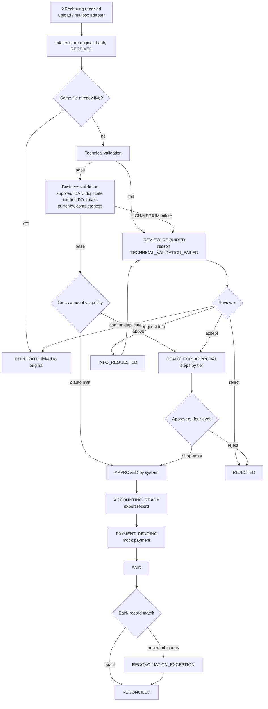

# Soll-Prozess (target process)

Legend, updated as phases land: ✅ implemented and covered by a test,
⚠️ partially implemented, ❌ planned.

| Step | Automated? | Human gate | Status |
|---|---|---|---|
| Intake, hashing, immutable storage | yes | - | ✅ |
| Exact duplicate file | yes | - | ✅ |
| Technical validation | yes | failure → review | ✅ |
| Business validation | yes | any HIGH/MEDIUM → review | ✅ |
| Routing and tier calculation | yes | - | ✅ |
| Straight-through approval ≤ auto limit | yes | - | ✅ |
| Review decision | no | AP clerk / Finance | ✅ |
| Approval steps | no | MANAGER / FINANCE / CFO, different actors | ✅ |
| Accounting record and export | yes | - | ❌ Phase 3 |
| Payment instruction (mock) | yes | - | ❌ Phase 3 |
| Reconciliation | yes | ambiguous → human | ❌ Phase 3 |
| KPIs | yes | - | ❌ Phase 4 |

Deliberately human: every IBAN change, every unknown supplier, every PO overrun,
every approval above the auto limit, every ambiguous bank match.
