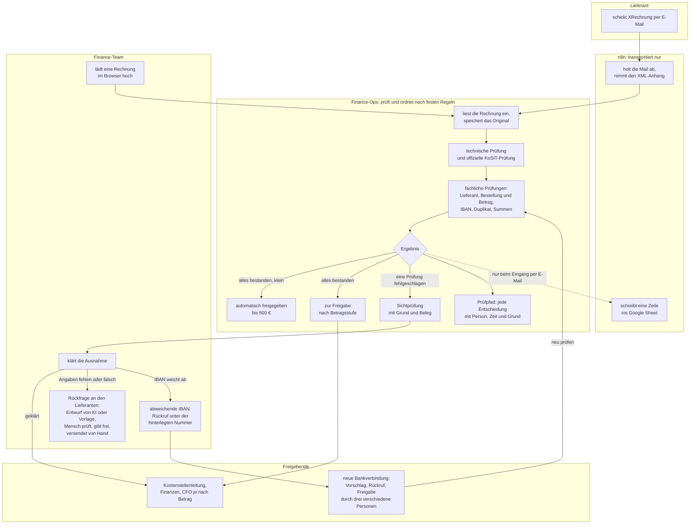
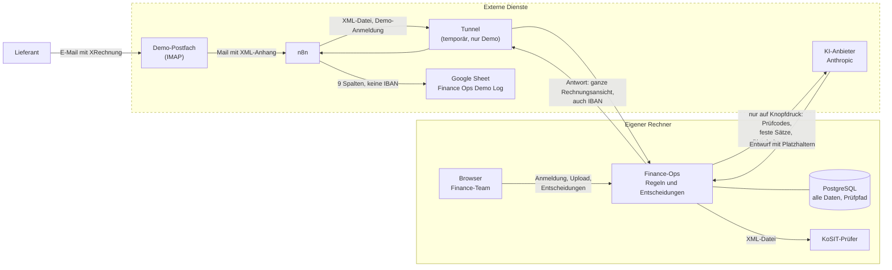

# Prozess und Datenfluss

Zwei Diagramme für den Rechnungseingang der fiktiven Nordwerk GmbH: wer was
tut (Prozess) und welche Daten wohin gehen (Datenfluss). Stand: 19.10.2026,
mit der KI-gestützten Lieferantenrückfrage (ADR-084).

## 1. Prozess: wer tut was

Die Regeln stehen an einer Stelle, in Finance-Ops. n8n transportiert nur,
Menschen klären Ausnahmen und geben frei.

Danach folgen Buchung (CSV-Export), Zahlung und Abgleich mit dem
Kontoauszug. Zahlung und Kontoauszug sind simuliert.

**Drei Ausgänge, jeder mit Grund:**

| Ausgang | Wann | Wer handelt |
|---|---|---|
| Automatisch freigegeben | alle Prüfungen bestanden, bis 500 € | niemand |
| Zur Freigabe | alle Prüfungen bestanden, über 500 € | Kostenstellenleitung; über 5.000 € auch Finanzen; über 25.000 € auch CFO |
| Sichtprüfung | mindestens eine Prüfung fehlgeschlagen | Finance-Team; danach noch mindestens eine Freigabe |

**Wo die KI hilft und wo nicht.** Bei einer Ausnahme kann ein Mensch einen
KI-Entwurf der Rückfrage an den Lieferanten anfordern. Die Anwendung prüft den
Entwurf, ein Mensch bearbeitet ihn, gibt ihn frei und versendet ihn von Hand.
Bei einer abweichenden IBAN gibt es keinen Entwurf: Dort gilt nur der Rückruf
unter der hinterlegten Nummer. Die KI entscheidet in keinem Fall, und ohne KI
läuft der Prozess unverändert.

## 2. Datenfluss: welche Daten wohin gehen

Im gestrichelten Rahmen stehen die externen Dienste. Alles andere lief in der
Demo auf dem eigenen Rechner.

| Empfänger | Was ankommt | Bankdaten? | Gespeichert |
|---|---|---|---|
| **Demo-Postfach** | die Mail mit der XRechnung | ja, die IBAN steht in der Rechnung | beim Mailanbieter |
| **n8n** | die XML-Datei und die Antwort von Finance-Ops, also die ganze Rechnungsansicht | **ja**: IBAN der Rechnung und die hinterlegten IBANs aus der Prüfung | in den Ausführungsdaten von n8n, je nach Einstellung der Instanz |
| **Tunnel** | dieselben Daten wie n8n, über HTTPS; der Tunnelanbieter (Cloudflare) leitet sie weiter | ja, auf dem Weg | nur in der Demo genutzt |
| **Google Sheet** | Eingang, Rechnungsnummer, Lieferant, Betrag, Ergebnis, Status, Grund, Invoice ID, Eingangskanal | **nein**: Der Grund nennt eine IBAN-Abweichung, nie die IBAN | in Google Drive |
| **KoSIT-Prüfer** | die XML-Datei | ja | nein; läuft im eigenen Netz, die Datei verlässt das System nicht |
| **KI-Anbieter** | nur freigegebene Prüfinformationen, nur auf Knopfdruck, standardmäßig aus | höchstens eine gekürzte IBAN bei der Erklärung; bei der Rückfrage keine | beim Anbieter nach dessen Bedingungen; in Finance-Ops genau das, was gesendet wurde |

Die Antwort an n8n ist dieselbe wie im Browser. Für die Demo ist das
gewollt, weil n8n die Werte für die Sheet-Zeile braucht. Für ein Echtsystem
gehört sie auf das Nötige gekürzt. Siehe
[RISIKO_UND_DATENSCHUTZ_DE.md](RISIKO_UND_DATENSCHUTZ_DE.md), Abschnitt zu
n8n und Google Sheets.

## 3. Warum die Aufgaben so verteilt sind

- **Regeln an einer Stelle.** In einem früheren Referenzprojekt liefen Regeln
  in n8n-Knoten auseinander (ADR-004). Hier ruft n8n nur die
  Upload-Schnittstelle auf. Rechte und Regeln gelten dort genau wie beim
  Upload im Browser.
- **n8n ist austauschbar.** Fällt n8n aus, bleiben die Mails im Postfach, und
  das Team lädt die Rechnungen im Browser hoch. Am Ergebnis ändert das nichts.
- **Das Sheet ist nur Anzeige.** Es wirkt nicht auf Finance-Ops zurück. Der
  verbindliche Nachweis ist der Prüfpfad in der Anwendung.
- **Eine grüne n8n-Ausführung heißt nicht „freigegeben“.** Grün heißt nur:
  transportiert. Ob eine Rechnung frei ist, entscheidet Finance-Ops.
