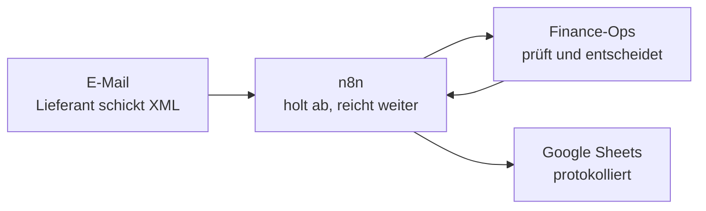

# Finance Operations Automation (DE) – Projektbeschreibung

Stand: 17. Oktober 2026. Abschlussprojekt des Kurses, vorgestellt Ende
Oktober 2026.

Dieses Dokument beschreibt das ganze Projekt an einer Stelle: Anlass, Problem,
Lösung, Automatisierung mit n8n, Kontrollen, Verhalten bei Ausfällen, Technik,
Qualitätssicherung, Vorgehen und Präsentation. Es ersetzt die Detaildokumente
nicht, sondern verweist auf sie (Abschnitt 18).

> **Einordnung.** Die Nordwerk GmbH ist erfunden, alle Daten sind
> synthetisch. Das Projekt ist ein Proof of Concept, keine Produktivsoftware.
> Es beansprucht keine Konformität mit EN 16931, GoBD oder DSGVO. Alle
> Zahlen zu Aufwand und Einsparung sind Modellannahmen, nichts davon ist
> gemessen.

---

## Auf einen Blick

| | |
|---|---|
| **Was** | Eine Anwendung, die Eingangsrechnungen im Format XRechnung annimmt, prüft, nach festen Regeln einordnet und genau dort stoppt, wo ein Mensch entscheiden muss |
| **Für wen** | Das Finance-Team eines Mittelständlers; im Projekt die fiktive Nordwerk GmbH und ihr Mitarbeiter Jonas Weber |
| **Kernidee** | Routine läuft automatisch durch. Ausnahmen kommen mit Grund, Beleg und nächstem Schritt zum Menschen |
| **Eingang** | Upload in der Anwendung, oder per E-Mail: n8n holt die Mail ab und übergibt die Datei |
| **Entscheidung** | Feste Geschäftsregeln in der Anwendung. Eine optionale KI erklärt nur, sie entscheidet nichts |
| **Technik** | Node.js 22, Express 5, PostgreSQL 14, React 19; n8n und Google Sheets für Eingang und Protokoll in der Demo |
| **Umfang** | 190 Commits auf `main` seit dem 17.09.2026, 751 automatisierte Tests (CI-Lauf vom 17.10.2026), 83 dokumentierte Architekturentscheidungen (ADR) |
| **Präsentation** | 16 Folien, geplant 19:15 Minuten, mit 4:05 Minuten Demo-Video und Referentenansicht |

---

## 1. Anlass: Woher das Thema kommt

Ich habe in den Operations eines FinTech-Unternehmens gearbeitet, das
Girokonten für Privatkunden anbietet. Zwei meiner Bereiche waren Pfändungen
und behördliche Auskunftsersuchen. Dort habe ich erlebt, wie viele
Arbeitsschritte sich ständig wiederholen, von Hand erledigt werden und kaum
automatisiert sind: Schreiben lesen und einordnen, die richtige Person
finden, Kunden- und Kontodaten zusammensuchen, die Antwort fristgerecht
erstellen und die Bearbeitung festhalten.

Das Projekt baut diesen Prozess **nicht** nach. Es überträgt die Erfahrung
auf einen anderen Fall, in dem dasselbe Grundmuster steckt:

```
Eingang → Abgleichen → Regeln → Ausnahme? → Entscheiden → Nachweis
```

Ein Dokument kommt an, Daten werden abgeglichen, feste Regeln angewendet,
Abweichungen erkannt, ein Mensch entscheidet dort, wo es nötig ist, und am
Ende ist jeder Schritt belegt. Es gibt kein Abbild der Systeme oder Abläufe
des früheren Arbeitgebers.

Warum gerade die Eingangsrechnung:

- **Strukturiert:** Eine XRechnung enthält die Daten maschinenlesbar. Regeln
  lassen sich sauber und nachvollziehbar prüfen.
- **Vorführbar:** Mit synthetischen Testdaten lässt sich der ganze Ablauf
  zeigen, ohne echte Kunden oder Konten.
- **Aktuell:** Seit Januar 2025 müssen inländische Unternehmen E-Rechnungen
  empfangen können (Quelle: BMF, FAQ E-Rechnung).

---

## 2. Das Geschäftsproblem

**Nordwerk GmbH** ist ein ausgedachter Mittelständler mit rund 2.000
Eingangsrechnungen im Monat, etwa 100 pro Arbeitstag (Modellannahme).

**Der Alltag heute** (fiktiver Ist-Prozess, `docs/IST_PROCESS.md`): Jonas
Weber aus dem Finance-Team öffnet jeden Anhang und legt ihn ab, tippt Daten
ab, vergleicht Lieferant und IBAN mit dem Auge, sucht die Bestellung und läuft
Freigaben per Mail hinterher. Bei jeder Rechnung.

**Das Risiko:** Eine echt aussehende Rechnung mit einem fremden Konto ist ein
bekanntes Muster beim Rechnungsbetrug. Bekannter Lieferant, passende
Bestellung, Betrag im Rahmen – nur die IBAN ist eine andere. Von Hand fällt
das nur auf, wenn jemand jedes Mal genau hinschaut, auch bei der hundertsten
Rechnung des Tages.

**Was Jonas eigentlich wissen will:** Muss ich mir diese Rechnung ansehen?
Wenn ja, warum genau? Und was ist der nächste Schritt?

**Die verpasste Chance:** Rechnungen kommen zunehmend als strukturierte
E-Rechnung. Der manuelle Prozess nutzt diese Struktur nicht.

---

## 3. Ziele und Erfolgskriterien

Die Kriterien stammen aus dem Projektsteckbrief für den Kurs. Sie beruhen auf einer
Modellrechnung und wären in einem Pilot zu messen.

| Ziel | Kriterium | Status |
|---|---|---|
| Weniger manueller Aufwand | von rund 327 auf rund 80 Stunden im Monat | modelliert, nicht gemessen |
| Routine läuft durch | mindestens 8 von 10 Rechnungen ohne manuelle Sachprüfung; jede Ausnahme mit Grund und Beleg | in der Demo gezeigt, nicht an echten Daten gemessen |
| Keine Zahlung auf ein fremdes Konto | 100 % der Rechnungen mit abweichender IBAN vor der Zahlung gestoppt; keine Bankverbindung ändert sich ohne Rückruf und Freigabe durch weitere Personen | im System erzwungen und getestet |

**Nicht im Umfang:** echte Zahlungen und Bankanbindung (Zahlungen sind
simuliert, Kontoauszüge kommen als Import), Anbindung an Buchhaltung oder ERP
wie DATEV (Buchungssätze nur als CSV-Export), Papier- und PDF-Rechnungen mit
Texterkennung (nur strukturierte XRechnung).

---

## 4. Die Lösung im Überblick

Die Anwendung **Finance-Ops** automatisiert den Weg einer Eingangsrechnung
vom Eingang bis zur Abstimmung mit dem Kontoauszug:

```
Rechnungseingang
→ technische Validierung
→ offizielle KoSIT-Validierung (optional in der Entwicklung, Pflicht im Produktionsmodus)
→ fachliche Prüfung gegen die eigenen Stammdaten
→ deterministisches Routing
→ menschliche Prüfung und Freigabe, wenn nötig
→ Buchungssatz und simulierte Zahlung
→ Abstimmung mit dem Kontoauszug
→ Kennzahlen und Prüfpfad für jeden Statuswechsel
```

Jede Rechnung landet in genau einem von drei Ergebnissen:

| Ergebnis | Wann |
|---|---|
| **Automatisch freigegeben** | alle Prüfungen bestanden, Betrag bis 500 EUR |
| **Zur Freigabe** | alle Prüfungen bestanden, höherer Betrag: Freigabe durch die zuständigen Rollen |
| **Zur Prüfung** | eine Prüfung ist fehlgeschlagen oder nicht sicher prüfbar: mit Grund, Beleg und nächstem Schritt zum Menschen |

**Deterministisch** heißt: gleiche Daten, gleiche Regeln, gleiches Ergebnis.
Kein Modell schätzt, ob eine Rechnung in Ordnung ist.

---

## 5. Eingang per E-Mail: die Rolle von n8n

Für die Präsentation kommt eine Rechnung so an, wie sie es in einem
Unternehmen täte: per E-Mail. Die Arbeitsteilung ist dabei klar getrennt.



| Baustein | Aufgabe | Was er nicht tut |
|---|---|---|
| **E-Mail** | bringt die XRechnung als Anhang in ein Demo-Postfach | – |
| **n8n** | holt neue Mails ab, nimmt den XML-Anhang, meldet sich bei Finance-Ops an, übergibt die Datei, schreibt das Ergebnis ins Sheet | n8n enthält keine einzige Geschäftsregel und entscheidet nichts |
| **Finance-Ops** | prüft die Rechnung und entscheidet nach festen Regeln | – |
| **Google Sheets** | protokolliert jede Rechnung als Zeile | reine Anzeige, keine Rückwirkung auf Finance-Ops |

> **Eine grüne n8n-Ausführung bedeutet nicht automatisch eine freigegebene
> Rechnung.** Grün heißt nur: n8n hat transportiert. Ob eine Rechnung frei
> ist, entscheidet Finance-Ops. In der Demo sind beide Ausführungen grün, das
> Ergebnis ist aber einmal „automatisch freigegeben“ und einmal „zur
> Prüfung“.

Die Entscheidung, die Regeln nicht in n8n zu legen, ist alt (ADR-004): In
einem früheren Referenzprojekt waren Regeln in n8n-Knoten auseinandergelaufen.
n8n ruft deshalb nur die bestehende Upload-Schnittstelle auf, mit dem
Eingangskanal als Zusatzangabe. Die Anwendung prüft Rechte und Regeln dort
genauso wie bei einem Upload im Browser.

### Der Workflow Knoten für Knoten

Workflow „Finance Ops – Invoice Intake Demo“, 12 Knoten (dazu eine Notiz):

| Gruppe | Knoten | Aufgabe |
|---|---|---|
| Eingang | **Rechnung per E-Mail** | holt ungelesene Mails mit Anhang aus dem Demo-Postfach (IMAP) |
| Eingang | **Rechnung per Formular** | zweiter Eingangsweg über ein n8n-Formular; in der Demo nicht genutzt |
| Eingang | **XML vorbereiten** | nimmt nur XML-Anhänge und merkt sich den Eingangskanal (E-Mail oder Formular); ohne XML endet der Lauf |
| Finance-Ops | **CONFIG – Finance Ops API** | enthält nur die Adresse von Finance-Ops, keine Regeln |
| Finance-Ops | **Finance Ops Login** | meldet sich mit einem Demo-Konto der Kreditorenbuchhaltung an |
| Finance-Ops | **Session vorbereiten** | übernimmt aus der Antwort den Nachweis der Anmeldung (Sitzung und CSRF-Token) |
| Finance-Ops | **Datei + Session zusammenführen** | legt Rechnung und Anmeldung zusammen |
| Finance-Ops | **Rechnung prüfen** | schickt die Datei an Finance-Ops; dort wird geprüft und entschieden |
| Google Sheets | **Ergebnis vorbereiten** | übersetzt die Antwort in lesbare Wörter, etwa „Zur Prüfung“ statt eines Codes |
| Google Sheets | **Demo Log aktualisieren** | schreibt eine Zeile ins Sheet „Finance Ops Demo Log“ |
| Formularweg | **Über Formular eingereicht?** | nur wenn die Rechnung über das Formular kam … |
| Formularweg | **Bestätigung anzeigen** | … zeigt n8n dort eine Bestätigung; bei E-Mail endet der Lauf nach dem Sheet |

Spalten im Sheet: Eingang, Rechnungsnummer, Lieferant, Betrag, Ergebnis,
Status, Grund, Invoice ID, Eingangskanal.

Zugangsdaten liegen nur in n8n-Credentials, nicht im Workflow-Text. Finance-Ops
lief für die Demo lokal und war über einen temporären Tunnel erreichbar.
Im Test am 11.10.2026 dauerte eine n8n-Ausführung 2 bis 4 Sekunden, von der
Abholung der Mail bis zur Zeile im Sheet.

---

## 6. Prüfungen und Routing

### Was geprüft wird

Jede Prüfung liefert ein strukturiertes Ergebnis: Prüfung, Status, Schwere,
**erwartet**, **gefunden**, Grund und empfohlener nächster Schritt. Das System
sagt also nicht „verdächtig“, sondern zeigt den Beleg. Bei einer IBAN sind
die abweichenden Zeichen markiert.

| Bereich | Beispiele |
|---|---|
| Technisch | gültiges XML, sichere Verarbeitung, Pflichtfelder vollständig |
| Offiziell | KoSIT-Validator 1.6.3 mit XRechnung-Konfiguration 3.0.2 vom 31.08.2026, versionsgebunden (ADR-078) |
| Lieferant | bekannt, aktiv, IBAN gehört zu den freigegebenen Bankverbindungen; Zahlungsziel wie in den Stammdaten (Abweichung nur als Hinweis) |
| Käufer und Währung | Rechnung ist an Nordwerk adressiert, Währung wie erwartet |
| Bestellung | Bestellnummer vorhanden, Bestellung existiert, gehört zum Lieferanten, Betrag in der Toleranz |
| Beträge | jede Zeile aus Menge und Preis nachgerechnet, Summen über die Rechenkette geprüft, auf den Cent genau (ADR-047, ADR-048) |
| Duplikate | gleiche Datei (Inhalt, SHA-256) oder gleiche Rechnungsnummer des Lieferanten (ADR-009) |
| Gutschriften | Bezug auf die gutgeschriebene Rechnung |

**Fail closed:** Was fehlt, fehlerhaft ist oder sich nicht lesen lässt, gilt
als fehlgeschlagene Prüfung, nicht als übersprungene. Eine Zeile, die sich
nicht nachrechnen lässt, stoppt die Rechnung (ADR-081). Manche Prüfungen kann
kein Prüfer übersteuern: eine geänderte IBAN, ein Rechenfehler in den Summen
oder eine abgelehnte KoSIT-Prüfung.

### Freigabestufen

Demo-Annahmen, konfigurierbar; jede Routing-Entscheidung speichert die Regeln,
nach denen sie getroffen wurde.

| Bruttobetrag | Freigabe |
|---|---|
| bis 500 EUR, ohne Auffälligkeit | automatisch |
| bis 5.000 EUR | Kostenstellenleitung |
| bis 25.000 EUR | Kostenstellenleitung und Finanzen |
| darüber | Kostenstellenleitung, Finanzen und CFO |

---

## 7. Menschliche Kontrolle

Menschliche Freigabe ist hier kein Zeichen fehlender Automatisierung, sondern
Teil davon. Das System prüft, sortiert und leitet weiter. Menschen entscheiden
dort, wo es um Urteil und Verantwortung geht.

### Funktionstrennung, vom Server erzwungen

- Wer eine Ausnahme aus der Prüfung entlässt, darf diese Rechnung nicht
  freigeben.
- Wer eine Rechnung eingereicht hat, darf sie nicht freigeben.
- Niemand entscheidet zwei Freigabestufen derselben Rechnung.
- Wer freigegeben hat, darf die Zahlung weder anweisen noch bestätigen.
- Eine Prüfung endet nie direkt in „freigegeben“, sondern immer in mindestens
  einer Freigabestufe (ADR-010). Eine Rechnung, die einmal eine Ausnahme war,
  braucht immer einen Menschen (ADR-020).

Die Oberfläche blendet aus, was eine Rolle nicht darf. Verbindlich entscheidet
aber immer der Server.

### Eine neue Bankverbindung: drei Personen

Was, wenn der Lieferant wirklich die Bank gewechselt hat? Dann gilt: **Eine
Rechnung kann die Bankverbindung nie ändern.** Die IBAN auf einer Rechnung
ist genau das, was ein Betrüger kontrolliert. Deshalb gibt es einen eigenen
Weg (ADR-077):

1. **Person 1 schlägt vor:** neue Bankverbindung mit Begründung.
2. **Person 2 ruft zurück:** nur über die Nummer, die bereits in den
   Stammdaten steht, nie über eine Nummer von der Rechnung. Der Lieferant liest
   die IBAN vor.
3. **Person 3 gibt frei:** Erst dann gilt das Konto als bekannt.
4. **Das System prüft erneut:** automatisch, mit allen Prüfungen.
5. **Danach die Rechnungsfreigabe:** eine eigene, zweite Entscheidung. Eine
   gestoppte Rechnung wird nie automatisch freigegeben, ein Mensch
   unterschreibt.

Freigabe der Bankverbindung und Freigabe der Rechnung sind also **getrennte
Entscheidungen**.

Die Grundidee ist das bekannte Vier-Augen-Prinzip: Wer vorschlägt, prüft und
gibt nicht selbst frei. **Drei Personen sind die Regel dieses Projekts**, im
System fest eingestellt, keine allgemeine Pflicht. Ein Zwei-Personen-Modus ist
im Datenmodell vorbereitet, aber bewusst nicht freigegeben.

Wichtig für die Einordnung: **Eine IBAN-Abweichung ist kein Nachweis für
Betrug.** Das System erkennt nur, dass die IBAN nicht zu den freigegebenen
Bankverbindungen passt. Ob es Betrug ist oder ein echter Bankwechsel, klärt
der Rückruf. Das System sorgt dafür, dass vorher nicht gezahlt wird.

---

## 8. Geld-Pfad: Buchung, Zahlung, Abstimmung

- Eine freigegebene Rechnung wird als **Buchungssatz** an die Buchhaltung
  übergeben, eine Zeile pro Steuersatz (ADR-053), als CSV-Export.
  Kontonummern und Steuerschlüssel sind Demo-Zuordnungen, keine zertifizierte
  SKR-Abbildung.
- Die **Zahlung** ist simuliert. Jede Zahlung trägt eine eigene
  End-to-End-Kennung (zum Beispiel `NW-P-00000001`). Bezahlt wird nur auf ein
  aktives, hinterlegtes Konto eines aktiven Lieferanten, geprüft im Moment der
  Anweisung.
- Die **Abstimmung** ordnet Zeilen eines synthetischen Kontoauszugs den
  Zahlungen zu, nur über diese Kennung und den Betrag. Ein Betrag allein
  ordnet nie etwas zu (ADR-016); was nicht eindeutig passt, wird eine Ausnahme
  für einen Menschen.
- **Gutschriften** laufen durch dieselben Prüfungen, werden nie bezahlt und
  verringern die nächste Zahlung an denselben Lieferanten (ADR-049, ADR-050).

---

## 9. KI: Rolle und Grenzen

**Feste Regeln entscheiden, die optionale KI erklärt nur.**

- Die KI-Funktion ist optional und standardmäßig ausgeschaltet. Demo, Tests,
  CI und Docker laufen ohne sie.
- Bei einer gestoppten Rechnung kann ein Prüfer eine kurze Erklärung
  anfordern: warum gestoppt, was ein möglicher nächster Schritt wäre. Sie ist
  als Vorschlag gekennzeichnet, nicht als Entscheidung.
- Sie hat keinen Einfluss auf Routing, Freigabe, Stammdaten, Zahlung oder
  Abstimmung. Ein Test schlägt fehl, sobald solcher Code die KI-Funktion
  einbindet.
- Gesendet werden nur ausdrücklich freigegebene, minimierte Prüfinformationen;
  IBANs nur gekürzt, keine Namen, keine Rechnungsdatei (ADR-082). Jede Antwort
  wird vor der Anzeige gegen die Belege geprüft (ADR-080).
- Eine Bewertung mit dem echten Modell steht aus, weil für das Projekt keine
  kostenpflichtige API-Nutzung freigeschaltet ist.

Warum die KI hier nur erklärt: Eine falsche Erklärung kostet einen Prüfer
einen Moment. Eine falsche Freigabe bewegt Geld.

---

## 10. Wenn etwas ausfällt

Ein **fachlicher Stopp** ist kein Ausfall. Wird eine Rechnung wegen einer
abweichenden IBAN gestoppt, arbeitet das System genau wie vorgesehen. Ein
**technischer Ausfall** heißt: Ein Baustein ist nicht erreichbar.

| Ausfall | Was man sieht | Nächster Schritt |
|---|---|---|
| n8n nicht erreichbar | keine Ausführung; die Mails bleiben im Postfach, nichts wird geprüft | Rechnungen direkt in Finance-Ops hochladen |
| Verbindung oder Finance-Ops weg | n8n bricht beim Anmelden ab, rot in den Ausführungen; keine Rechnung, keine Sheet-Zeile; die Mail gilt für n8n als abgeholt | Verbindung herstellen, dann erneut senden oder hochladen |
| Google Sheets weg | Finance-Ops hat geprüft und entschieden; nur die Protokollzeile fehlt, n8n rot beim letzten Schritt | Zeile nachtragen; erneut senden ergäbe nur „Duplikat“ |

**Was eingebaut ist** (belegt in Code und Tests):

- Doppelt senden ist sicher: Dieselbe Datei wird als Duplikat erkannt, nichts
  wird doppelt freigegeben (ADR-009).
- Bricht eine Prüfung mittendrin ab, setzt dieselbe Datei sie beim erneuten
  Senden fort (ADR-044).
- Ist der offizielle Prüfdienst nicht erreichbar, geht die Rechnung in die
  Sichtprüfung, nie in die Freigabe; eine gezielte Wiederholung ist möglich
  (ADR-078). In der Demo ist dieser Prüfdienst aus.
- Spuren: n8n zeigt den Schritt, an dem eine Ausführung abbrach (belegt mit
  einer echten Fehlausführung, Nr. 51289). Finance-Ops führt den Verlauf jeder
  Rechnung und ein Server-Protokoll als JSON-Zeilen (ADR-060).

**Was heute von Hand nötig ist:** Ausführungen in n8n prüfen, Ursache
beheben, Rechnung erneut senden oder hochladen, fehlende Sheet-Zeile
nachtragen.

**Was noch nicht gebaut ist:** Heute meldet sich kein System von selbst.
Einen Ausfall sieht, wer nachschaut. Nächste Schritte wären eine automatische
Benachrichtigung bei einem Fehler (etwa ein n8n-Fehler-Workflow an ein
Team-Postfach), Dauerbetrieb statt temporärem Tunnel und das automatische
Nachholen fehlender Sheet-Zeilen. Nicht getestet ist bisher, ob n8n nach einem
Neustart die Mails abholt, die währenddessen angekommen sind.

---

## 11. Kennzahlen und Nutzen

### Modellrechnung (nicht gemessen)

| Annahme | Wert |
|---|---|
| Rechnungen pro Monat | 2.000 |
| Anteil mit Klärungsbedarf | 20 % (jede fünfte) |
| Zeit je saubere Rechnung | 6 Minuten heute, 1 Minute mit dem System |
| Zeit je Ausnahme | 25 Minuten heute, 8 Minuten mit dem System |

| | Heute | Mit System |
|---|---|---|
| 1.600 saubere Rechnungen | 160 h | 26,7 h |
| 400 Ausnahmen | 166,7 h | 53,3 h |
| **Summe pro Monat** | **rund 327 h** | **rund 80 h** |

Die Minutenwerte sind in der Anwendung als Annahmen hinterlegt
(`server/config/assumptions.js`) und werden im Dashboard neben jeder daraus
berechneten Zahl angezeigt. Ob das in einem echten Unternehmen so ist, müsste
ein Pilot messen. `docs/BUSINESS_CASE.md` rechnet zusätzlich eine engere
Variante nur für die strukturierten Rechnungen (1.200 im Monat, 196 h auf
36,8 h); auch sie ist eine Annahme.

### Kennzahlen in der Anwendung

Jede Kennzahl im Dashboard wird aus den Rechnungen und ihrem Prüfpfad
berechnet, nicht gezählt (ADR-025), und nennt ihre Quelle: synthetische
Demodaten, Modellannahme oder beides (ADR-079). Kundenwerte und Pilotergebnis
stehen auf „nicht gemessen“. Beispiele: Durchlaufquote ohne Handarbeit,
Ausnahmegründe, Durchlaufzeiten als Median, Arbeitsliste, modellierte
Einsparung.

### Was sich für Jonas ändert

- Routine läuft durch, ohne Sichtprüfung.
- Ausnahmen kommen mit Grund: erwartet und gefunden.
- Er entscheidet gezielt, wo Verantwortung gefragt ist.
- Jeder Schritt ist belegt: wer, wann, was.

---

## 12. Architektur und Technik

| Schicht | Umsetzung |
|---|---|
| Server | Node.js 22, Express 5; alle Geschäftsregeln liegen hier |
| Datenbank | PostgreSQL 14, Zugriff über `pg` |
| Oberfläche | React 19 mit Vite; zeigt an, entscheidet nichts; Deutsch, umschaltbar auf Englisch |
| Offizielle Prüfung | KoSIT-Validator als lokaler Dienst (Java) |
| Eingang und Protokoll (Demo) | n8n und Google Sheets |
| Betrieb (Demo) | `docker compose up` startet eine Demo mit einem Monat synthetischer Rechnungen |

**Tragende Entscheidungen:**

- **Ein Weg für Statuswechsel.** Der Status einer Rechnung ändert sich nur
  über eine einzige Funktion, die im selben Datenbankvorgang den Prüfpfad
  schreibt. Die erlaubten Wechsel stehen in einer festen Tabelle (ADR-002).
- **Prüfpfad.** Jeder Statuswechsel wird mit Person, Zeitpunkt, Grund und
  Beleg gespeichert. Im Produktionsmodus darf die Datenbankrolle der
  Anwendung den Prüfpfad nur ergänzen, nicht ändern (ADR-068).
- **Letzte Kontrolle vor der Unterschrift.** Bevor eine Freigabe gespeichert
  wird, laufen die fachlichen Prüfungen noch einmal gegen die aktuellen
  Stammdaten (ADR-041).
- **Idempotenz über die Datenbank.** Doppelte Verarbeitung wird durch
  Datenbankregeln verhindert, nicht durch vorherige Abfragen (ADR-017).
- **Sicherheit.** Passwörter mit scrypt, Sitzung als HttpOnly-Cookie, nur ihr
  Hash gespeichert, CSRF-Token, Drosselung nach Adresse statt nach Konto,
  Sicherheits-Header, Originaldateien nur als Text ausgeliefert (ADR-035,
  ADR-040, ADR-059, ADR-074).
- **Sicherer Start.** Im Produktionsmodus startet die Anwendung nicht mit
  Demo-Passwort, ohne KoSIT-Prüfer oder mit einer Datenbankrolle, die den
  Prüfpfad ändern könnte (ADR-058).

Details: `docs/ARCHITECTURE.md`, alle Entscheidungen: `docs/DECISIONS.md`.

---

## 13. Qualitätssicherung

- **751 automatisierte Tests** (CI-Lauf vom 17.10.2026): Unit-Tests,
  Integrationstests gegen eine echte Datenbank, Browsertests und Tests gegen
  den echten KoSIT-Prüfer.
- **CI bei jeder Änderung:** Abhängigkeitsprüfung, Tests, Build, Start der
  Docker-Demo.
- **Testmatrix:** `docs/TEST_MATRIX.md` ordnet jedem Geschäftsrisiko seinen
  Test zu und listet bekannte, nachgestellte Grenzen.
- **Unabhängige Reviews** der Kontrolllogik (`docs/PHASE_0_INDEPENDENT_REVIEW.md`,
  `docs/PROJECT_REVIEW_2026-09-17.md`), Befunde behoben und dokumentiert. Ein
  weiteres Review vor dem Feature Freeze fand drei Lücken, die als Härtung
  behoben wurden (ADR-081 bis ADR-083).
- **Testdaten gegen den offiziellen Standard:** Vor dem Einbau des KoSIT-Prüfers
  zeigte eine Machbarkeitsprüfung, dass die Testdaten den Standard zunächst
  nicht erfüllten. Das wurde vor der Integration behoben.

### Demo-Szenarien

Die Testrechnungen in `fixtures/xrechnung/` decken die wichtigsten Fälle ab.
Die Präsentation zeigt G und B.

| Datei | Fall | Ergebnis |
|---|---|---|
| A | sauber, 1.240 EUR | wartet auf eine Freigabe der Kostenstellenleitung |
| **B** | IBAN weicht von den Stammdaten ab (Havel Logistik, 2.499 EUR) | zur Prüfung, Schwere hoch |
| C | Rechnung 8.500 EUR, Bestellung noch 5.000 EUR offen | zur Prüfung, Schwere hoch |
| D | gleiche Nummer wie A, andere Datei | zur Prüfung, Duplikatverdacht |
| E | sauber, 30.000 EUR | Kostenstellenleitung, Finanzen und CFO |
| F | fehlerhafte Datei | zur Prüfung, technischer Fehler |
| **G** | sauber, 380 EUR (Berliner Bürobedarf) | automatisch freigegeben |
| H | IBAN weicht ab, 380 EUR | zur Prüfung; ein kleiner Betrag ist kein Grund, die Prüfung zu überspringen |
| I | 3 % Skonto auf die Positionen | automatisch freigegeben |
| J | Gutschrift über 214,20 EUR | gebucht als negativer Satz, nie bezahlt |

---

## 14. Vorgehen und Zeitverlauf

Jeder Schritt folgte demselben Muster: Entscheidung als ADR festhalten, Tests,
Umsetzung, Prüfung gegen die volle Testsuite, eigener Branch, Pull Request mit
grüner CI, Merge. Riskante Vorhaben wurden vorher in einer Machbarkeitsprüfung
erkundet.

| Zeitraum | Phase | Ergebnis |
|---|---|---|
| 17.–18.09.2026 | Funktionsfähiger PoC | Ablauf vom Eingang bis zu den Kennzahlen, echte Anmeldung, Gutschriften, englische Oberfläche, CI; unabhängige Reviews und deren Behebung |
| 23.–29.09.2026 | Härtung | IBAN nie durchwinkbar, Funktionstrennung bei Zahlungen, geschützter Prüfpfad, sicherer Produktionsstart, Demo mit einem Befehl |
| 29.–30.09.2026 | Standardkonforme Testdaten | KoSIT-Machbarkeitsprüfung; Testdaten so korrigiert, dass der offizielle Prüfer sie akzeptiert |
| 30.09.2026 | Kontrollfunktionen | Drei-Personen-Prozess für Bankverbindungen (ADR-077), KoSIT-Integration (ADR-078), Kennzahlen mit Quelle (ADR-079), optionale KI-Erklärung (ADR-080), UI-Polish, korrigierende Härtung (ADR-081 bis 083) |
| ab 30.09.2026 | **Feature Freeze** | nur noch Fehlerbehebung, Dokumentation, Demo-Stabilisierung und Polish ohne neues Verhalten |
| 01.10.2026 | Kursdokumentation | Projektabschluss, Risiko und Datenschutz, Rollout und Reflexion |
| Oktober 2026 | Demo mit n8n | n8n-Workflow für den Eingang per E-Mail und das Protokoll in Google Sheets; Checkliste für die Live-Demo |
| 11.–17.10.2026 | Präsentation | Folien, Sprechtext, Demo-Video (Aufnahme 15.10.2026), Ausfallplan, Zeitprobe, Referentenansicht |

Der n8n-Workflow ist keine neue Produktfunktion: Er nutzt die bestehende
Upload-Schnittstelle von Finance-Ops, an der Geschäftslogik wurde dafür nichts
geändert.

---

## 15. Die Abschlusspräsentation

16 Folien, geplant 19:15 Minuten (Rahmen bis 20 Minuten). Die letzte
vollständige Probe dauerte 18:46 Minuten, damals noch mit dem kürzeren Video.

| Folie | Inhalt | Plan |
|---|---|---|
| 1 | Titel | 0:20 |
| 2 | Eine Rechnung wie jede andere | 0:50 |
| 3 | Der zweite Blick: alles stimmt, nur das Konto nicht | 1:00 |
| 4 | Woher ich das kenne | 1:30 |
| 5 | Anderer Prozess, gleiches Grundproblem | 1:15 |
| 6 | Für wen: Jonas | 1:00 |
| 7 | Vorher / Nachher | 1:15 |
| 8 | Zwei Rechnungen, zwei Ergebnisse | 0:40 |
| 9 | Demo-Video (4:05) | 4:15 |
| 10 | Was Jonas bei einer Ausnahme sieht | 0:20 |
| 11 | Menschliche Kontrolle: drei Personen | 1:20 |
| 12 | Gestoppt ist nicht ausgefallen | 1:40 |
| 13 | Was hält, was noch fehlt | 1:10 |
| 14 | Geschäftlicher Nutzen | 1:15 |
| 15 | Reflexion | 1:00 |
| 16 | Abschluss: „Ihre Fragen?“ | 0:25 |

**Demo-Video** (`docs/course/praesentation/demo_v4.mp4`, 4:05, ohne Ton,
echte Aufnahmen vom 15.10.2026): zwei Mails mit den Rechnungen G und B, der
n8n-Workflow Knoten für Knoten, zwei grüne Ausführungen, zwei Zeilen im Sheet
mit zwei verschiedenen Ergebnissen, dann Finance-Ops: Posteingang, die
freigegebene Rechnung mit Verlauf, die gestoppte Rechnung mit Grund, Beleg,
übrigen Prüfungen und nächstem Schritt. Adressen und Zugangsdaten sind nicht
sichtbar. Das Video wird live gesprochen; Zeitmarken im Sprechtext.

**Werkzeuge für den Vortrag:**

- `praesentation_v4.html`: eine einzelne Datei mit eingebettetem Video, läuft
  ohne Server; Leertaste, K oder Klick pausieren das Video.
- **Referentenansicht:** Taste S öffnet ein zweites Fenster mit dem Sprechtext
  der aktuellen Folie. Es folgt dem Folienwechsel aus beiden Fenstern und auf
  Folie 9 der Stelle im Video.
- **Zeitprobe:** eine Seite mit Stoppuhr pro Folie und Prompter-Ansicht fürs
  Handy.
- `docs/PRAESENTATIONSTAG_DE.md`: Checkliste für Vortag, Morgen und Vortrag.

---

## 16. Grenzen und was für einen echten Betrieb fehlt

**Bewusste Grenzen des Proof of Concept:**

- Nur XRechnung in UBL-Syntax; CII und ZUGFeRD sind vorgesehen, aber nicht
  gebaut.
- Eine Bestellung ist ein einzelner Restbetrag, ohne Teillieferungen.
- Teil- und Sammelzahlungen werden zu Ausnahmen für einen Menschen.
- Eine neue Bankverbindung wird ergänzt; alte Konten stillzulegen ist nicht
  gebaut.
- Anmeldung auf Demo-Niveau: echte Passwörter, Sitzungen und Rollen, aber
  kein Passwort-Zurücksetzen, keine Zwei-Faktor-Anmeldung, kein SSO.
- Buchhaltung, Zahlungen und Bankdaten sind simuliert.
- Freigabegrenzen und Einsparungen sind Demo-Annahmen.

**Für einen echten Betrieb fehlen:** Bankanbindung (SEPA pain.001,
Kontoauszüge camt.053/054), ein Export, den die Buchhaltung importiert (etwa
DATEV), SSO mit zweitem Faktor, fester Server statt Tunnel, Backups,
revisionssichere Ablage der Originale, zentrale Logs mit Alarmen, der
KoSIT-Prüfer als Dienst, automatische Benachrichtigung bei Ausfällen und ein
Pilot mit echten, gemessenen Werten.

---

## 17. Reflexion

**Was ich mitnehme:**

- Die schwierigste Frage war nicht, was sich automatisieren lässt, sondern
  wo ein Mensch entscheiden muss, und wer genau.
- Feste Regeln schaffen Vertrauen: Jede Entscheidung lässt sich begründen.
- Eine Demo braucht Betriebsdisziplin: Die temporäre Tunnel-Adresse fiel
  mehrfach weg. Daraus entstanden eine feste Checkliste und der Ausfallplan.

**Nächste Schritte:**

1. Pilot mit echten Rechnungen: anonymisiert, die Regeln gemeinsam mit dem
   Finance-Team abgestimmt.
2. Stabiler Betrieb: fester Server statt Tunnel, KoSIT-Prüfung dauerhaft
   aktiv.
3. Anbindung an Buchhaltung (ERP, DATEV) und Bank.

---

## 18. Weiterführende Dokumente

| Dokument | Inhalt |
|---|---|
| `README.md` | Überblick, Einrichtung, Demo-Konten, bekannte Grenzen (Englisch) |
| `docs/course/COURSE_FINAL_DE.md` | Projektabschluss vom 01.10.2026: Stakeholder, Methode, Status |
| `docs/course/RISIKO_UND_DATENSCHUTZ_DE.md` | Risikoanalyse und Datenschutzkonzept |
| `docs/course/ROLLOUT_UND_REFLEXION_DE.md` | Rollout- und Change-Konzept, Lessons Learned |
| `docs/course/praesentation/` | Präsentation, Demo-Video, Sprechtext; frühere Fassung in `referenz/` |
| `docs/PRAESENTATIONSTAG_DE.md` | Checkliste für den Präsentationstag |
| `docs/ARCHITECTURE.md` | Aufbau, Datenmodell, Zustände, Schnittstellen |
| `docs/DECISIONS.md` | 83 Architekturentscheidungen |
| `docs/TEST_MATRIX.md` | was wie getestet ist, bekannte Grenzen |
| `docs/IST_PROCESS.md`, `docs/SOLL_PROCESS.md` | Ist- und Soll-Prozess |
| `docs/BUSINESS_CASE.md` | Annahmen der Wirtschaftlichkeitsrechnung |
| `docs/DEMO.md` | Ablauf einer Vorführung in der Anwendung |
